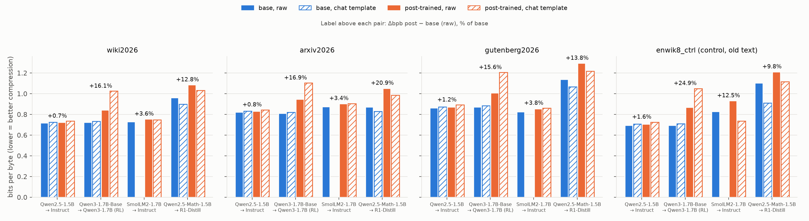

# exp01: does post-training change fresh-text compression?

Run on 2026-10-13 on an M2 Pro (16 GB), MPS, float16.

## Verdict

**Yes. Post-training made compression worse in all 4 pairs, on all 3 fresh corpora, and under every scoring convention we tried. The size of the loss does not track the capability gain.**

| pair (base → post-trained) | Δbpb RAW, mean of 3 fresh corpora | Δbpb, both in their chat template | type of post-training |
|---|---|---|---|
| Qwen2.5-1.5B → Instruct | **+0.9%** | +1.8% | SFT + DPO/GRPO |
| SmolLM2-1.7B → Instruct | **+3.6%** | n/a (the base has no template); post chat vs base raw +3.3% | SFT + DPO |
| Qwen3-1.7B-Base → Qwen3-1.7B | **+16.2%** | +37.0% | Qwen3 post-training (thinking/non-thinking modes); see note |
| Qwen2.5-Math-1.5B → R1-Distill-Qwen-1.5B | **+15.8%** | +16.0% | SFT on long-CoT R1 traces |

- Every one of the 12 pair × fresh-corpus RAW deltas is positive.
- Its paired-bootstrap 95% CI over windows excludes 0. The narrowest is Qwen2.5 on wiki2026: +0.7% [+0.5, +0.8].
- Swapping the document-start token for a plain `\n\n` gives the same signs and similar sizes: +0.9%, +4.1%, +17.0%, +20.9%.

The penalty is small for light SFT/DPO (1–4%) and large for RL or long-CoT distillation (about 16%).

Note on the "type" column, from memory and not re-checked here: the Qwen3 report says its small dense models are post-trained by strong-to-weak distillation from the RL-trained flagship models, not by running the four-stage RL pipeline themselves. If so, both large-penalty models are students distilled from a much larger reasoning teacher, and "distilled from a reasoning teacher" may be the common factor rather than RL as such. Next step 1 tests this. It is not proportional to the capability gain. Qwen2.5-Instruct gains +20 points on MATH and +24 on HumanEval at a cost of under 1% in bpb.

So bits-per-byte on fresh text measures how far a model sits from the pre-training distribution. It is not a capability score once post-training is involved. That fits Huang et al.'s decision to exclude fine-tuned models.

## Method

**Corpora.** All are UTF-8 and stored in `data/`. Each has a provenance file `*.prov.json` listing the URL and date of every document.

| corpus | bytes | chars | docs | dates | notes |
|---|---|---|---|---|---|
| wiki2026 | 101,843 | 101,589 | 17 | created 2026-10-05 … 10-13 | Pages from MediaWiki `recentchanges rctype=new` (newest 5,000 creations), creation date checked with `rvdir=newer`. 6 are event pages with "2026" in the title (Azerbaijani protests, Poland school stabbings, US–Denmark–Greenland agreement, …). 11 are other brand-new articles, added because only 11 of the 2026-titled pages had at least 600 characters of prose lead. Reference sections dropped; articles capped at 12k chars. |
| arxiv2026 | 100,041 | 99,872 | 80 | published 2026-10-09 | `Title. Abstract` blocks, 40 from cs.LG and 40 from math.AP, interleaved. |
| gutenberg2026 | 106,023 | 104,188 | 4 | released 2026-10-12/13 | Fallback for news: en.wikinews.org has had no new article since May 2026. Four books, about 26 KB from each, taken past the front matter. **Caveat:** these are new transcriptions of old public-domain books (1900s–1920s), so the text may already be in pre-training data from other scans. |
| enwik8_ctrl | 100,000 | 99,504 | 1 | 2006 | enwik8 bytes 1,000,000–1,100,000. Old text that every model has seen; used as a control. |

**Models.** Four pairs, listed in the verdict table. Within each pair the tokenizers produce **identical token ids** on all four corpora, and decoding round-trips exactly (`results/tokcheck.json`). So bpb and bits/token are directly comparable within a pair.

**Metric (`score_bpb.py`).**
1. Tokenize the corpus with `add_special_tokens=False`.
2. Split it into consecutive non-overlapping windows of ≤1024 tokens. A boundary moves left by a token if it would split a UTF-8 character, so the window texts concatenate back to the corpus exactly.
3. Run one forward pass per window and take −log₂ p from the float32 log-softmax.
4. **Every** text token is scored. bpb = Σ bits / UTF-8 bytes of the corpus; bpc = Σ bits / chars. Token counts, tokens/byte and bits/token are in `results/bpb.csv`.

**Conditions.**
- **RAW:** input = `[doc_start] + window`.
  - doc_start is the tokenizer's BOS if its config adds one. Only R1-Distill does: `<｜begin▁of▁sentence｜>`.
  - Otherwise it is the pre-training document separator `<|endoftext|>`.
  - Deviation from the brief: the brief allowed conditioning the first token on nothing. Using a separator means every byte is coded, so the totals are complete code lengths.
- **CHAT:** `apply_chat_template([user: "Continue the text.", assistant: TEXT])`, cut just before TEXT. Qwen3 uses `enable_thinking=False`, which renders an empty `<think>\n\n</think>\n\n`. Only TEXT tokens are scored. Default system prompts are kept. Every rendered prefix is listed in `results/sanity.md`.
- CHAT was also run for the base models that ship a template: Qwen2.5-1.5B, Qwen3-1.7B-Base and Qwen2.5-Math-1.5B. SmolLM2-1.7B has no template, so it has no CHAT row.

**Sanity checks** (all in `results/sanity.md`):

- **(a) GPT-2 (124M) on the enwik8 control: 1.243 bpb**, inside the expected 1.1–1.3. GPT-2 on arxiv2026: 1.276.
- **(b) Our summed bits equal HF's `labels=` loss × n / ln 2** for every model. Relative difference is at most 1e-7.
- **(c) Repeated forward passes are bit-identical** for every model.
- **(d) fp16 vs fp32 agree to within 1.9e-4 (relative)** on window 0 for every model.
  - The fp32 reference runs in its own process.
  - Separately, 9 suspicious windows (extreme surprisal or outlier window mean) were re-scored in fp32. They differ from fp16 by at most 5.7e-4, and one was also confirmed on CPU.
- The Qwen-family bases score **0.69 bpb** on enwik8, below the 0.9–1.3 guess in the brief. GPT-2 and the labels check say the mechanics are right; the likely reason is memorisation of 2006 Wikipedia plus 18–36T-token training.

**Compute.**
- Main table: about 21 min of scoring; the slowest model took 3.9 min including load and checks.
- `\n\n` ablation: 11 min more.
- Nothing was cut to 40 KB.

## bpb table

RAW and CHAT, bpb. Full rows including bpc, tokens and wall-clock are in `results/bpb.csv` and `results/summary.md`.

| pair | corpus | base raw | post raw | **Δ raw** | base chat | post chat | Δ chat vs chat | post chat vs base raw |
|---|---|---|---|---|---|---|---|---|
| qwen2.5 | wiki2026 | 0.719 | 0.723 | **+0.7%** | 0.725 | 0.735 | +1.4% | +2.2% |
| qwen2.5 | arxiv2026 | 0.824 | 0.831 | **+0.8%** | 0.831 | 0.844 | +1.6% | +2.4% |
| qwen2.5 | gutenberg2026 | 0.862 | 0.873 | **+1.2%** | 0.871 | 0.891 | +2.3% | +3.3% |
| qwen2.5 | enwik8_ctrl | 0.695 | 0.706 | +1.6% | 0.706 | 0.725 | +2.8% | +4.4% |
| qwen3 | wiki2026 | 0.726 | 0.842 | **+16.1%** | 0.733 | 1.024 | +39.8% | +41.2% |
| qwen3 | arxiv2026 | 0.810 | 0.946 | **+16.9%** | 0.819 | 1.103 | +34.8% | +36.3% |
| qwen3 | gutenberg2026 | 0.872 | 1.008 | **+15.6%** | 0.882 | 1.205 | +36.5% | +38.1% |
| qwen3 | enwik8_ctrl | 0.695 | 0.868 | +24.9% | 0.708 | 1.050 | +48.3% | +51.2% |
| smollm2 | wiki2026 | 0.729 | 0.755 | **+3.6%** | — | 0.747 | — | +2.5% |
| smollm2 | arxiv2026 | 0.876 | 0.905 | **+3.4%** | — | 0.904 | — | +3.2% |
| smollm2 | gutenberg2026 | 0.825 | 0.856 | **+3.8%** | — | 0.859 | — | +4.2% |
| smollm2 | enwik8_ctrl | 0.828 | 0.932 | +12.5%† | — | 0.736 | — | −11.1%† |
| qwen2.5-math | wiki2026 | 0.963 | 1.086 | **+12.8%** | 0.899 | 1.032 | +14.9% | +7.3% |
| qwen2.5-math | arxiv2026 | 0.871 | 1.053 | **+20.9%** | 0.829 | 0.986 | +19.0% | +13.3% |
| qwen2.5-math | gutenberg2026 | 1.137 | 1.294 | **+13.8%** | 1.067 | 1.218 | +14.1% | +7.1% |
| qwen2.5-math | enwik8_ctrl | 1.103 | 1.211 | +9.8% | 0.909 | 1.116 | +22.8% | +1.2% |

† **SmolLM2 on enwik8 is an artefact of the document-start token, not of post-training.**
- With `<|endoftext|>` before the window, both SmolLM2 models fail badly on 2 of the 34 enwik8 windows. They put 40–55 bits on tokens that should be near-certain, such as " talk" after "[[User".
- This is genuine model behaviour, not a numerical fault: fp32 on MPS and fp32 on CPU give the same result.
- With a `\n\n` prefix the failures disappear: base 0.674, instruct 0.727 (+7.9%).
- On the fresh corpora the prefix choice moves SmolLM2's bpb by only 0.3–2.2%.

`results/fig_bpb_pairs.png`: solid bars are RAW, hatched bars are CHAT. The label over each pair is Δ RAW.

## Robustness: is it real, and what is it?

**1. Document-start convention** (full table in `results/summary.md`). RAW Δ% on the fresh corpora with the special-token start (main table) versus a plain `\n\n` start:

| pair | special-token start | `\n\n` start |
|---|---|---|
| qwen2.5 | +0.7 / +0.8 / +1.2 | +0.7 / +0.9 / +1.3 |
| qwen3 | +16.1 / +16.9 / +15.6 | +17.0 / +18.2 / +15.9 |
| smollm2 | +3.6 / +3.4 / +3.8 | +4.1 / +3.7 / +4.4 |
| math → R1 | +12.8 / +20.9 / +13.8 | +22.6 / +21.9 / +18.2 |

The start token matters a lot for some models:
- Qwen2.5-Math base is 5–7% better on fresh text with `\n\n` than with `<|endoftext|>`, and 18% better on enwik8.
- R1-Distill given id 151643 (its EOS) instead of its BOS is 8.5% worse on arxiv: 1.142 vs 1.053.

The sign of every delta survives every convention we tried. Giving each model its best condition (RAW, CHAT or `\n\n`, whichever is lowest) still leaves Qwen2.5 +0.9%, SmolLM2 +4.1%, Qwen3 +16.4% and math → R1 +16.4% (mean of the fresh corpora).

**2. Not a window-start effect** (`results/positions.md`). Restricting to tokens with at least 128 tokens of in-window context gives almost the same deltas:

| pair | Δ bits/token at position ≥128, fresh corpora |
|---|---|
| Qwen2.5 | +0.8 … +1.2% |
| SmolLM2 | +3.6 … +4.0% |
| Qwen3 | +16.2 … +17.7% |
| math → R1 | +15.1 … +23.6% |

**3. Broad, not driven by a few catastrophic tokens** (same file). On the fresh corpora, for Qwen3 and R1:
- The median per-token Δ is about 0 for Qwen3 (−0.005 to 0 bits) and +0.02 to +0.21 bits for R1.
- The post-trained model is worse on only 43–63% of tokens.
- The worst 1% of tokens account for just 11–19% of the extra bits.

The picture is a sharper, more confident distribution. It wins a little on easy tokens and loses a lot on surprising ones. In CHAT, Qwen3-1.7B puts 36–53 bits on plausible tokens such as " Gore" after "After returning from Vietnam,". fp32 confirms these values, so they are real overconfidence rather than fp16 error.

**4. CHAT does not rescue the post-trained models,** even though the template is the format they were tuned on.
- Qwen3-1.7B is much worse in CHAT (1.02–1.20 bpb) than in RAW (0.84–1.01). Qwen2.5-Instruct is also slightly worse in CHAT.
- SmolLM2-Instruct scores about the same in both.
- R1 gains 5–6% in CHAT, but its base gains as much (Qwen2.5-Math also prefers the chat prefix to `<|endoftext|>`), so R1 still trails its base in CHAT by 14–19%.

## Capability deltas (official sources)

Numbers are copied from the sources named below and are not re-measured here.
- **SmolLM2 and R1 numbers:** I checked them against the downloaded model cards (`logs/model_cards/`).
- **Qwen numbers:** a sub-agent extracted them from the arXiv HTML. I have not re-checked them myself; spot-check before citing.
- Base and post-trained models are usually scored with different prompting (few-shot vs chat), and some benchmark names differ (MATH vs MATH-500, GPQA vs GPQA-Diamond).
- "n/a" means the number was not found. Nothing was guessed.

**Qwen2.5-1.5B → Instruct**
- Model cards: https://huggingface.co/Qwen/Qwen2.5-1.5B and https://huggingface.co/Qwen/Qwen2.5-1.5B-Instruct. Neither card has numbers; both link to the report below.
- Source: Qwen2.5 Technical Report, https://arxiv.org/html/2412.15115, Table 5 (base) and Table 10 (instruct).

| benchmark | base | instruct | Δ |
|---|---|---|---|
| MMLU-Pro | 28.5 | 32.4 | +3.9 |
| MMLU-redux | 58.5 | 50.7 | **−7.8** |
| GPQA | 24.2 | 29.8 | +5.6 |
| MATH | 35.0 | 55.2 | **+20.2** |
| GSM8K | 68.5 | 73.2 | +4.7 |
| HumanEval | 37.2 | 61.6 | **+24.4** |
| MBPP | 60.2 | 63.2 | +3.0 |
| MultiPL-E | 33.1 | 50.4 | +17.3 |
| IFEval | n/a | 42.5 | n/a |

The HF team scored the same two models on one harness; the numbers are in the comparison tables of the SmolLM2 cards:

| benchmark | base | instruct | Δ |
|---|---|---|---|
| HellaSwag | 66.4 | 60.9 | −5.5 |
| ARC (avg) | 58.5 | 46.2 | −12.3 |
| PIQA | 76.1 | 73.2 | −2.9 |
| MMLU-Pro (MCF) | 13.7 | 24.2 | +10.5 |
| GSM8K (5-shot) | 61.3 | 42.8 | −18.5 |

**Qwen3-1.7B-Base → Qwen3-1.7B**
- Model cards: https://huggingface.co/Qwen/Qwen3-1.7B-Base and https://huggingface.co/Qwen/Qwen3-1.7B. Both link to the report below.
- Source: Qwen3 Technical Report, https://arxiv.org/html/2505.09388, Table 8 (base), Table 19 (thinking), Table 20 (non-thinking).

| benchmark | base | thinking | non-thinking (the mode scored here) |
|---|---|---|---|
| MMLU-Redux | 61.66 | 73.9 | 64.4 |
| GPQA (base) vs GPQA-Diamond (post) | 28.28 | 40.1 | 28.6 |
| MATH 4-shot (base) vs MATH-500 (post) | 43.50 | 93.4 | 73.0 |
| AIME'24 | n/a | 48.3 | 13.4 |
| LiveCodeBench v5 | n/a | 33.2 | 11.6 |
| IFEval | n/a | 72.5 | 68.2 |

Only MMLU-Redux is matched between base and post-trained: +12.2 in thinking mode, +2.7 in non-thinking mode.

**SmolLM2-1.7B → Instruct**
- Sources: https://huggingface.co/HuggingFaceTB/SmolLM2-1.7B and https://huggingface.co/HuggingFaceTB/SmolLM2-1.7B-Instruct.

| benchmark | base | instruct | Δ |
|---|---|---|---|
| HellaSwag | 68.7 | 66.1 | −2.6 |
| ARC (avg) | 60.5 | 51.7 | −8.8 |
| PIQA | 77.6 | 74.4 | −3.2 |
| MMLU-Pro (MCF) | 19.4 | 19.3 | −0.1 |
| GSM8K (5-shot) | 31.0 | 48.2 | **+17.2** |
| IFEval | n/a | 56.7 | n/a |
| MT-Bench | n/a | 6.13 | n/a |

**Qwen2.5-Math-1.5B → DeepSeek-R1-Distill-Qwen-1.5B**
- Base model card: https://huggingface.co/Qwen/Qwen2.5-Math-1.5B.
- Base numbers: Qwen2.5-Math Technical Report, https://arxiv.org/html/2409.12122, Table 2 (few-shot CoT).
  - GSM8K 8-shot 76.8, MATH 4-shot 49.8, MMLU-STEM 51.3.
  - MATH-500 and AIME'24 for the base are n/a.
- R1-Distill numbers: model card https://huggingface.co/deepseek-ai/DeepSeek-R1-Distill-Qwen-1.5B.
  - MATH-500 83.9, AIME'24 pass@1 28.9, GPQA-Diamond 33.8, LiveCodeBench 16.9, CodeForces 954.
  - The Qwen3 report's Table 19 adds MMLU-Redux 45.4 and IFEval 39.9.
- **No official source scores both models on the same benchmark, so the matched Δ is n/a.** The gain in long-CoT math is clearly large.

## Answer in plain language

Post-training makes small LLMs worse lossless compressors of new, unseen text in every pair we tested:
- Instruction tuning (SFT + preference) costs about 1–4%.
- RL-style reasoning training or long-CoT distillation costs about 16%.
- This holds when the text is wrapped in the chat format the models were tuned for, and under two different conventions for how each window starts.
- The extra bits are spread across the whole text rather than coming from a few disasters. Post-trained models are more confident, which pays off on easy tokens and costs heavily on surprising ones.

The change does **not** track capability:
- Qwen2.5-Instruct gains 20–24 points on MATH and HumanEval while losing under 1% in compression.
- Qwen3-1.7B loses 16% in compression while its matched gain in the non-thinking mode we scored is +2.7 MMLU-Redux.
- What the bpb penalty does track is how hard post-training pushed the model away from its pre-training distribution: RL and distillation more than SFT/DPO.
- The only benchmarks that move in step with bpb are the likelihood-scored cloze tasks (HellaSwag, ARC, PIQA), which also drop after instruction tuning. Even there the sizes don't line up: Qwen2.5 loses 3–12 cloze points for +0.9% bpb.

**Caveats:**
- n = 4 pairs, with heterogeneous benchmarks and few matched scores, so no correlation coefficient is meaningful.
- About 100 KB (20–26k tokens) per corpus. Huang et al. used about 3M characters. The window-bootstrap CIs are tight, but corpus-to-corpus spread is still visible.
- gutenberg2026 is a new transcription of old text.
- wiki2026 is 75% "new article" pages rather than 2026 event pages, because of throttling and the supply of 2026-titled pages.
- The capability numbers are not re-measured here.
- The R1 chat template has no `<think>`, so the first token of each window costs about 45 bits. That is ≤0.01 bpb.

## What failed, deviated or was not verified

- **Wikinews** has had no new article since May 2026, so news2026 was replaced by gutenberg2026 as the brief instructed.
- **Wikipedia API throttling.** Anonymous calls get HTTP 429 with Retry-After of about 17 s after roughly 3 quick calls. The fix was pacing at 1 call per 6 s, honouring Retry-After, limiting `recentchanges` paging to 10×500, and a batched lead-length pre-screen.
- **First scoring run killed.** Converting fp32 to fp16 in place (`model.half()`) kept the fp32 copy alive on MPS. RSS reached 12 GB, swap 12 GB, and one corpus took 1,505 s.
  - Fix: the fp32 reference now runs in a subprocess, with one process per model.
  - The affected Qwen3-1.7B-Base rows were deleted and recomputed.
  - An accidental concurrent run (a queuing bug) produced one row under contention. It was deleted and recomputed; the bpb was identical and only the wall time had been wrong.
- **Bug caught in audit.** SmolLM2-1.7B-Instruct's unk token is `<|endoftext|>`, so the first version of the doc-start logic fell back to `<|im_end|>` for that model only.
  - Fixed and re-run.
  - The old rows are kept as an ablation in `results/ablation_smollm2_instruct_imend_docstart.csv`. With `<|im_end|>`, enwik8 scored 0.724 instead of 0.932, and the fresh corpora moved by 0.5–2%.
- **`device_map` loading needs `accelerate`.** Not installed; plain `.to("mps")` is used instead.
- Model weights (about 27 GB) live in the shared HF cache `~/.cache/huggingface`, not in the project folder. GPT-2 was already there.
- **Not verified:**
  - No benchmark was run locally.
  - Qwen capability numbers were extracted by a sub-agent.
  - Freshness of the Gutenberg texts (see caveat above).
  - Whether the Wikipedia "new articles" are translations of older non-English articles. At least one, "Ultimate unification", may be.

## Next steps

1. **Attribute the penalty to stages and to RL vs SFT.**
   - Score OLMo-2-1B's staged checkpoints (base → SFT → DPO → RLVR).
   - Add RL-zero checkpoints trained directly from Qwen2.5-Math-1.5B, alongside R1-Distill (SFT) and Qwen2.5-Math-1.5B-Instruct.
   - Use about 3M characters per domain.
   - This tests whether RL from base costs less compression than distillation.
2. **Test calibration vs knowledge.**
   - Fit one temperature T per post-trained model on held-out fresh text and re-score.
   - Log the predictive entropy as well.
   - If T > 1 recovers most of the 16%, the lost compression is mostly sharpening, not lost knowledge, and "post-trained bpb at the best T" becomes a candidate capability metric.
3. **Close the capability loop on one harness.**
   - Run cloze tasks (ARC-E, HellaSwag, PIQA, LAMBADA) and generative GSM8K / MATH-500 locally for all 8 models.
   - Extend to 10–20 pairs at 0.1–2B parameters.
   - Test whether *base* bpb predicts *post-trained* scores (the claim in Information Capacity) and whether Δbpb vs Δscore has any slope.

## Files

- `collect_corpora.py`: corpora and provenance.
- `download_models.py`: model download.
- `score_bpb.py`:
  - `tokcheck`, `sanity`, `run`, `docstart` and `audit` subcommands;
  - `fp32ref`, an internal subcommand used by the checks.
- `analyze_positions.py`: position, concentration and bootstrap analysis.
- `plot_results.py`: the figure, `summary.md` and `sanity.md`.
- `run_all.sh`: runs the full pipeline.
- `results/bpb.csv`: the main table, with required columns plus tokens_per_byte, bits_per_token, n_windows, window, dtype and doc_start.
- `results/tokens/*.npy`: per-token bits for every run.
- `results/ablation_docstart.csv`: the `\n\n` start ablation.
- `results/fp32_audit.jsonl`: targeted fp32 re-scoring.
- `logs/notes.txt`: incident log.
- `logs/model_cards/`: the downloaded HF cards.
