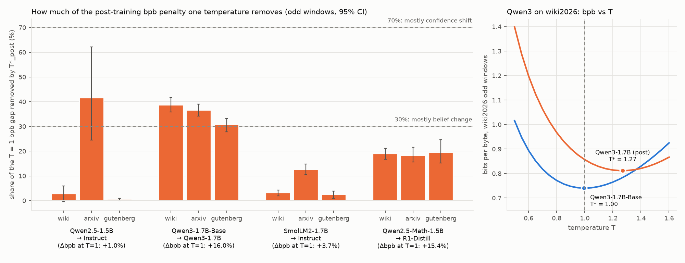

# exp02: does one temperature recover the post-training compression gap?

Run on 2026-10-14 on an M2 Pro (16 GB), MPS, float16 weights, float32 logits. Reproduce with `bash run_all.sh`; every number below is in `results/summary.md`, which `analyze_temperature.py` writes.

## Verdict

**Mostly not. One scalar temperature removes 35% of the Qwen3 gap and 19% of the R1-Distill gap on fresh text.** Under the rule stated before the run, that is a **mixed** result:
- Qwen3 lands in the "mixed" band, near its lower edge.
- R1-Distill lands in "mostly a change in beliefs".

| pair (base → post) | Δbpb at T=1 | T* base | T* post | gap recovered by T*_post | residual gap, both at own T* |
|---|---|---|---|---|---|
| Qwen2.5-1.5B → Instruct | +1.0% | 1.00–1.05 | 1.00–1.06 | 15% (3 / 42 / 1%) | +0.9% |
| SmolLM2-1.7B → Instruct | +3.7% | 1.00–1.05 | 1.04–1.08 | 6% (3 / 13 / 2%) | +3.6% |
| **Qwen3-1.7B-Base → Qwen3-1.7B** | **+16.0%** | 1.00–1.04 | **1.22–1.28** | **35%** (39 / 37 / 31%) | **+10.4%** |
| **Qwen2.5-Math-1.5B → R1-Distill-1.5B** | **+15.4%** | 1.02–1.07 | **1.15–1.18** | **19%** (19 / 18 / 20%) | **+12.7%** |

How to read the table:
- Every column uses odd windows only, averaged over the 3 fresh corpora.
- The per-corpus figures in brackets are in the order wiki / arxiv / gutenberg.
- T* is fit on the even windows.

What it means:
- **The big-penalty models are overconfident.** Qwen3's T* is about 1.25 and R1's about 1.16, while every base model sits at 0.995–1.07. Undoing that sharpening is worth 4–5% bpb for Qwen3 and 2–3% for R1.
- **Undoing it leaves most of the penalty in place.** Even with each model at its own best temperature, the post-trained model needs 10% (Qwen3) and 13% (R1) more bits than its base on the same fresh text.
- **The light SFT/DPO pairs are not overconfident at all.** Their T* is within 0.04 of the base's, and T* recovers only 6–15% of their small gap.
- So the exp01 penalty is not mainly a global confidence knob. Post-training changed which continuations the model expects, at least at the resolution of one scalar.

This weakens the "it's only calibration" reading of exp01 and leaves the "drift/forgetting meter" reading standing. Caveat: one global T is the crudest possible calibrator. A context-dependent miscalibration would show up here as "belief change" (see next steps).

## Rule (stated before the main run, in `run_all.sh`)

- recovered = (bpb_post(1) − bpb_post(T*_post)) / (bpb_post(1) − bpb_base(1)), on odd windows.
- Headline per pair = the mean of the per-corpus fraction over the 3 fresh corpora.
- If both big-penalty pairs (Qwen3, R1) recover ≥ 70%, the gap is mostly a confidence shift. If both recover ≤ 30%, it is mostly a change in beliefs. Otherwise it is mixed, reported per pair.

**Outcome:** Qwen3 35% (mixed band) and R1 19% (belief-change band), so the overall verdict is **mixed**.
- Qwen3's per-corpus CIs sit at 28–42%: above the 30% line on wiki and arxiv, straddling it on gutenberg [28%, 33%].
- No reading of the rule reaches the 70% "calibration" band for either pair.

## Method

- **Same setup as exp01, RAW condition only.**
  - The same 4 pairs and the corpora in `../exp01_posttraining_bpc/data/` (wiki2026, arxiv2026, gutenberg2026 and the enwik8 control).
  - The same 1024-token windows and the same document-start token.
- **Scoring** (`score_temperature.py run`): one fp16 forward pass per window, one process per model.
  - From the float32 logits of that pass: bits_T = Σ [logsumexp(z/T) − z_target/T] / ln 2 for T ∈ {0.50, 0.55, …, 1.60} (23 values).
  - Per-window, per-T sums go to `results/grid/<model>__<corpus>.npy`. Logits are not stored.
- **Fit.**
  - T* minimises total bits over the **even** windows: grid argmin, then a 3-point parabola in log T.
  - The **odd** windows are then scored on the grid *and* at T* exactly, from the same forward pass, into `*.tstar.npy`.
  - No T* landed on a grid edge.
- **Statistics** (`analyze_temperature.py`).
  - Base and post share identical windows within a pair (asserted), so bytes cancel in the recovered fraction.
  - 95% CIs come from 5,000 bootstrap resamples of odd windows (seed 0), using `cilab.stats.bootstrap_ci`.
- **Compute.** 25 min of scoring in total, at most 70 s per (model, corpus). The 8-min cut rule did not trigger, so the corpora were not cut to 60 KB.

## Per pair and corpus

The "gap recovered" and "residual" columns show the point estimate with its 95% CI.

| pair | corpus | n odd | Δbpb T=1 | T* base | T* post | gap recovered | residual at own T* |
|---|---|---|---|---|---|---|---|
| qwen2.5 | wiki2026 | 11 | +0.7% | 1.008 | 1.014 | 3% [−0, 6] | +0.7% [+0.4, +0.9] |
| qwen2.5 | arxiv2026 | 10 | +0.9% | 1.052 | 1.064 | 42% [25, 62] | +0.8% [+0.5, +1.0] |
| qwen2.5 | gutenberg2026 | 12 | +1.3% | 1.004 | 1.004 | 1% [0, 1] | +1.3% [+1.0, +1.6] |
| qwen2.5 | enwik8_ctrl | 15 | +1.5% | 1.016 | 1.034 | 7% [3, 10] | +1.4% [+1.2, +1.7] |
| qwen3 | wiki2026 | 11 | +15.7% | 0.995 | 1.270 | 39% [36, 42] | +9.6% [+8.8, +10.5] |
| qwen3 | arxiv2026 | 10 | +16.2% | 1.040 | 1.282 | 37% [34, 39] | +10.4% [+9.5, +11.4] |
| qwen3 | gutenberg2026 | 12 | +16.0% | 0.997 | 1.224 | 31% [28, 33] | +11.1% [+10.4, +11.8] |
| qwen3 | enwik8_ctrl | 15 | +23.8% | 1.008 | 1.375 | 42% [39, 45] | +13.7% [+12.0, +15.8] |
| smollm2 | wiki2026 | 11 | +4.0% | 1.004 | 1.041 | 3% [2, 4] | +3.9% [+3.3, +4.4] |
| smollm2 | arxiv2026 | 11 | +3.3% | 1.047 | 1.078 | 13% [10, 15] | +3.1% [+2.9, +3.3] |
| smollm2 | gutenberg2026 | 13 | +3.8% | 1.009 | 1.038 | 2% [1, 4] | +3.8% [+3.2, +4.3] |
| smollm2 | enwik8_ctrl | 17 | +15.5% | 1.022 | 1.066 | 13% [2, 15] | +13.8% [+4.9, +23.3] |
| qwen2.5-math → R1 | wiki2026 | 11 | +13.9% | 1.040 | 1.148 | 19% [17, 21] | +11.5% [+8.5, +14.8] |
| qwen2.5-math → R1 | arxiv2026 | 10 | +19.8% | 1.070 | 1.177 | 18% [16, 22] | +16.6% [+12.9, +20.5] |
| qwen2.5-math → R1 | gutenberg2026 | 12 | +12.5% | 1.020 | 1.153 | 20% [15, 25] | +10.1% [+7.7, +12.6] |
| qwen2.5-math → R1 | enwik8_ctrl | 15 | +9.1% | 1.064 | 1.175 | 36% [21, 139] | +6.4% [−0.3, +13.0] |

Per-model bpb at T=1 and at T* is in `results/summary.md`. For example, Qwen3-1.7B on wiki2026 goes from 0.857 to 0.812 bpb, while its base stays at 0.740.

`results/fig_temperature.png`:
- **Left:** the share of the T=1 gap removed by T*_post, per pair and fresh corpus, with 95% CIs. The dashed lines are the rule's 30% and 70% thresholds.
- **Right:** bpb vs T for Qwen3-1.7B-Base and Qwen3-1.7B on wiki2026 (odd windows), with each model's T* marked. The post curve's minimum moves right but stays about 0.07 bpb above the base's.

## Sanity and robustness

- **T=1 matches exp01.** At T = 1.00, the per-window bits equal exp01's saved RAW per-token bits summed per window for 28 of 32 runs, with a maximum relative difference of **1.6e-6** (criterion 1e-4).
  - The 4 exceptions are Qwen2.5-1.5B and -Instruct on arxiv2026 and enwik8_ctrl, at 1.2e-4 to 4.3e-4 per window and ≤ 2.1e-5 in total.
  - Their exp01 reference rows came from exp01's superseded in-process `.half()` path, which used fp16 rotary buffers; this was found during the cilab refactor and is noted in exp01's RESULTS.
  - Re-scoring those 4 today with exp01's own code path (`score_temperature.py recheck`) matches the grid to **≤ 1.1e-6** per window.
- **The fit is not biased.**
  - The 16 base-model T* values have a mean of 1.025 and a range of 0.995–1.070.
  - T* lowers base bpb by at most 0.42% on fresh text (0.55% on enwik8).
  - Every model, base or post, fits its highest fresh-corpus T* on arxiv2026, 0.01–0.06 above its wiki and gutenberg values. Fresh technical abstracts make all models a little overconfident.
- **T* is stable across halves.** Refitting T* on the odd windows instead of the even ones moves it by ≤ 0.02 on every fresh corpus.
  - The exception is SmolLM2 on enwik8: 1.022 → 1.081 and 1.066 → 1.194. This is the doc-start artefact windows from exp01.
- **The pair deltas reproduce exp01 on half the text.** On odd windows only, Δbpb at T=1 is +1.0 / +3.7 / +16.0 / +15.4% (full corpus in exp01: +0.9 / +3.6 / +16.2 / +15.8%).

## Failures and deviations

- Nothing failed and nothing was cut.
- The T=1 sanity criterion (≤ 1e-4 per window) was missed by the 4 stale exp01 reference rows described above. The re-check clears it.
- **Small-gap pairs give unstable fractions.** Qwen2.5 on arxiv (42% [25, 62] of a +0.9% gap) and R1 on enwik8 ([21%, 139%]) have tiny or noisy denominators. For those pairs, the residual-gap column is the better summary.
- Odd/even halves give 10–17 evaluation windows per corpus, so the CIs reflect variation in that text sample only.

## Next steps

1. **Richer calibrators before calling the residual "belief change".**
   - On the even windows, fit 2–3-parameter calibrators: a temperature per entropy bin, and a mixture with the base model's or a unigram distribution (ε-smoothing).
   - exp01 found the extra bits concentrated on surprising tokens, which a single T cannot target.
   - If ≥ 60% of the Qwen3/R1 gap survives these too, the residual is a change in beliefs in the strong sense.
2. **Decompose the residual by token.** For the same tokens, split post − base bits (at each model's T*) by whether post's top-1 prediction differs from base's, and by base entropy. Where the extra bits live tells what post-training overwrote.
3. **Track the overconfidence share separately in the AAU checkpoint sweep.** T* costs nothing extra once the grid is scored. Log T* and the residual at T* per checkpoint next to Δbpb, and test which of the two tracks lost general benchmarks. (Also: the CHAT condition, where Qwen3's gap is +37%, is untested here.)

## Files

- `score_temperature.py`: the `run` subcommand (grid scoring, T* fit, exact odd-window bits at T*, T=1 sanity) and the `recheck` subcommand.
- `analyze_temperature.py`: tables, bootstrap CIs, the rule and the figure, written to `results/summary.md` and `results/fig_temperature.png`.
- `run_all.sh`: the full pipeline, with the pre-stated rule in its header.
- `results/runs.csv`: T*, sanity and wall time per (model, corpus).
- `results/windows.csv`: tokens and bytes per window.
- `results/grid/*.npy`: per-window bits on the T grid, plus bits at T*.
- `results/t1_recheck.csv`: the re-check of the 4 runs.
- `logs/`: run logs.
- Shared code: `../cilab/calib.py` (temperature bits, T* fit, recovered statistic), `cilab/score.py`, `cilab/stats.py`, `cilab/text.py`.
