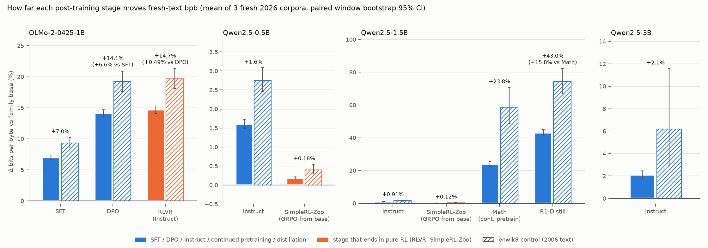

# exp03: fresh-text bpb drift per post-training stage

The run was on 2026-10-14 as AAU job 1080281 (commit 9562f71), on one Tesla T4 with fp16 weights and float32 logits. It took 18 min 42 s for 14 models × 4 corpora, with no failures and no fp32 fallbacks. The expectations below were committed in 9562f71 *before* the job was submitted and are left unedited. Every number here is in `results/summary.md`, which `analyze_stages.py` writes (`bash run_all.sh analyze`).

## Question

How far does each post-training stage move a model from its pretraining distribution, measured as Δbpb on fresh text against the family base? And does pure RL move it at all?

## Verdict

**SFT and DPO move a model far from its pretraining distribution. Pure RL barely moves it, and never lowers fresh-text bpb.**

| stage step (Δbpb vs its predecessor, mean of 3 fresh corpora, 95% CI) | Δbpb |
|---|---|
| OLMo-2-1B base → SFT | **+6.99%** [+6.61, +7.40] |
| OLMo-2-1B SFT → DPO | **+6.65%** [+6.38, +6.93] |
| OLMo-2-1B DPO → RLVR (Instruct) | **+0.49%** [+0.44, +0.55] |
| Qwen2.5-0.5B base → SimpleRL-Zoo (pure GRPO) | **+0.18%** [+0.16, +0.21] |
| Qwen2.5-1.5B base → SimpleRL-Zoo (pure GRPO) | **+0.12%** [+0.09, +0.14] |
| Qwen2.5 base → Instruct, at 0.5B / 1.5B / 3B | +1.61% / +0.91% / +2.08% |
| Qwen2.5-1.5B → Qwen2.5-Math-1.5B (continued pretraining) | +23.84% [+22.46, +25.41] |
| Qwen2.5-Math-1.5B → R1-Distill-1.5B | +15.81% [+14.35, +17.29] |
| Qwen2.5-1.5B → R1-Distill-1.5B (both steps) | +42.95% [+41.07, +44.93] |

- **No RL stage lowered bpb.** Under the pre-stated headline rule, no RL stage sits below its predecessor on any corpus. All 15 RL-step CIs (3 RL stages × 4 corpora plus the fresh mean) lie entirely above zero. "RL teaches general language modelling" (thread step 4) is not supported.
- **RL moves the meter, just very little.**
  - OLMo-2's RLVR step is 14× smaller than its SFT step.
  - SimpleRL-Zoo's pure-GRPO step is 8–9× smaller than Qwen2.5's full Instruct pipeline at the same size.
  - Every RL step is still detectably positive on every corpus.
- **OLMo-2's DPO step is as large as its SFT step.** It is +6.65% on top of SFT, against the +0 to +2% expected, so the DPO model sits +14.1% above base. On wiki2026 the DPO step (+7.25%) is larger than the SFT step (+6.61%).
- **Scale.** Qwen2.5 Instruct shows no monotone scale trend: +1.6% at 0.5B, +0.9% at 1.5B and +2.1% at 3B.
- **Reproduction.** The 4 models that exp01 scored on the Mac (MPS, torch 2.14) reproduce on the T4 (NGC torch 2.9) within **5e-5 bpb** on all 16 rows. The tolerance was 1e-3.

`results/fig_stages.png` shows one panel per family:
- Each bar is Δbpb versus the family base. Solid bars are the fresh-corpus mean and hatched bars the enwik8 control, with 95% CIs.
- Orange marks stages whose last step is pure RL.
- Labels on chained stages also give their own step versus their parent. For example, RLVR reads "+0.49% vs DPO" while its bar reaches +14.7% versus base.

## Pre-registered expectations against the outcome

| # | expected | observed (fresh mean, 95% CI) | verdict |
|---|---|---|---|
| E1 | OLMo-2 SFT vs base +3 to +8%, largest OLMo-2 step | +6.99% [+6.61, +7.40]; largest step by 0.34 points over DPO, CIs overlap | met (narrowly on "largest") |
| E2 | OLMo-2 DPO vs SFT +0 to +2% | +6.65% [+6.38, +6.93] | **not met**: about 3× the upper bound |
| E3 | OLMo-2 RLVR vs DPO within ±1% | +0.49% [+0.44, +0.55] | met |
| E4 | SimpleRL-Zoo 0.5B vs base +0.5 to +3% | +0.18% [+0.16, +0.21] | **not met**: smaller than expected, still > 0 |
| E5 | SimpleRL-Zoo 1.5B vs base +0.5 to +3% | +0.12% [+0.09, +0.14] | **not met**: smaller than expected, still > 0 |
| headline | any RL stage below its predecessor with the CI under 0 | none, on any corpus | not triggered |

## Expectations (pre-registered 2026-10-14, before the run)

Δbpb is the RAW condition, averaged over the 3 fresh corpora (wiki2026, arxiv2026, gutenberg2026), with paired window-bootstrap 95% CIs. A range counts as **met** when the point estimate falls inside it.

| # | comparison | expected Δbpb |
|---|---|---|
| E1 | OLMo-2-0425-1B-SFT vs OLMo-2-0425-1B (base) | +3 to +8%, and the largest single step in the OLMo-2 chain |
| E2 | OLMo-2-0425-1B-DPO vs -SFT (on top) | +0 to +2% |
| E3 | OLMo-2-0425-1B-Instruct (RLVR) vs -DPO (on top) | within ±1% |
| E4 | Qwen-2.5-0.5B-SimpleRL-Zoo vs Qwen2.5-0.5B (pure GRPO from the base) | +0.5 to +3% |
| E5 | Qwen-2.5-1.5B-SimpleRL-Zoo vs Qwen2.5-1.5B (pure GRPO from the base) | +0.5 to +3% |

**Headline rule.** If any RL stage (E3 RLVR vs DPO; E4 or E5 SimpleRL-Zoo vs base) is *below* its predecessor with the whole 95% CI under zero, that is the headline: RL lowered fresh-text bpb.

**Reported without a pre-stated number:**
- Qwen2.5 Instruct vs base at 0.5B, 1.5B and 3B (the scale control; exp01 measured +0.9% at 1.5B on the Mac).
- Qwen2.5-Math-1.5B vs Qwen2.5-1.5B.
- R1-Distill-Qwen-1.5B vs both of its references: Qwen2.5-Math-1.5B (its parent) and plain Qwen2.5-1.5B.
- The enwik8 control for every comparison.

**Reproduction check.** Four models were already scored on the Mac (MPS) in exp01: Qwen2.5-1.5B, Qwen2.5-1.5B-Instruct, Qwen2.5-Math-1.5B and R1-Distill-Qwen-1.5B. Their AAU bpb must match exp01 within 1e-3 bpb on every corpus, despite the different GPU and torch build.

## Method (fixed before the run)

- **Models.** 14 public checkpoints in 4 families, listed with stage, recipe and parent in `cilab/stages.py` (`STAGES`).
- **Corpora.** exp01's dated snapshots (`../exp01_posttraining_bpc/data`): wiki2026, arxiv2026, gutenberg2026 and the enwik8_ctrl control, about 100 KB each.
- **Scoring.** RAW condition only, identical to exp01:
  - 1024-token windows;
  - input = [doc-start, *window];
  - every text token is scored;
  - bpb = Σ bits / UTF-8 bytes.
- **Doc-start token.** The tokenizer's BOS if its config adds one, else `<|endoftext|>`, else EOS:
  - OLMo-2: its tokenizer config sets no `add_bos_token`, so `<|endoftext|>` (100257), which is also its BOS and EOS;
  - Qwen2.5 family: `<|endoftext|>` (151643);
  - R1-Distill: `<｜begin▁of▁sentence｜>` (151646).
- **Tokenizer identity.** The Mac preflight checked that the 4 OLMo-2 stages encode all 4 corpora to identical ids. So do all 10 Qwen2.5-derived models. All round-trip exactly. The job repeats the check (`results/tokcheck.json`). Identical ids make the windows identical, so the bootstrap pairs windows.
- **Compute.** One AAU job, one GPU, fp16 weights, float32 logits, one model at a time (one child process per model).
  - Each model is checked against fp32 on window 0. If the two disagree by ≥ 5e-3 relative, or fp16 gives non-finite bits, that model is scored in fp32.
  - Job: `infra/slurm/exp03.sbatch`. Scorer: `score_stages.py`.
- **Statistics** (`analyze_stages.py`). Paired window bootstrap, 5,000 resamples:
  - each corpus has its own fixed seed, so every comparison on a corpus uses the same resamples;
  - the fresh-corpus mean resamples windows within each corpus independently (`cilab.stats.stratified_mean_ci`).

## Preflight (Mac, 2026-10-14)

`bash run_all.sh preflight`, outputs in `logs/preflight/`:
- Qwen2.5-0.5B on enwik8_ctrl: **0.83937 bpb** on MPS (fp16). Window 0 in fp16 is within 1.3e-5 relative of fp32, and the score is deterministic.
- Tokenizer identity holds in both groups.
- A second run skipped the finished row (resume works).

## Results per corpus

Δbpb versus the family base, RAW, with 95% CIs. The step-vs-parent table, bpb per model and the per-model checks are in `results/summary.md`, and all deltas are in `results/stage_deltas.csv`.

| model | wiki2026 | arxiv2026 | gutenberg2026 | enwik8_ctrl | fresh mean |
|---|---|---|---|---|---|
| OLMo-2-0425-1B-SFT | +6.61% | +7.17% | +7.20% | +9.35% | +6.99% [+6.61, +7.40] |
| OLMo-2-0425-1B-DPO | +14.33% | +13.83% | +14.14% | +19.23% | +14.10% [+13.52, +14.69] |
| OLMo-2-0425-1B-Instruct (RLVR) | +14.69% | +14.78% | +14.52% | +19.66% | +14.66% [+14.05, +15.28] |
| Qwen2.5-0.5B-Instruct | +1.33% | +1.46% | +2.03% | +2.76% | +1.61% [+1.49, +1.73] |
| Qwen-2.5-0.5B-SimpleRL-Zoo | +0.18% | +0.27% | +0.10% | +0.40% | +0.18% [+0.16, +0.21] |
| Qwen2.5-1.5B-Instruct | +0.66% | +0.85% | +1.22% | +1.58% | +0.91% [+0.81, +1.01] |
| Qwen-2.5-1.5B-SimpleRL-Zoo | +0.11% | +0.19% | +0.06% | +0.28% | +0.12% [+0.09, +0.14] |
| Qwen2.5-Math-1.5B | +33.94% | +5.68% | +31.90% | +58.72% | +23.84% [+22.46, +25.41] |
| DeepSeek-R1-Distill-Qwen-1.5B | +51.07% | +27.75% | +50.04% | +74.30% | +42.95% [+41.07, +44.93] |
| Qwen2.5-3B-Instruct | +2.59% | +2.17% | +1.49% | +6.18% | +2.08% [+1.74, +2.47] |

Base-model bpb on the fresh mean:

| model | bpb (fresh mean) |
|---|---|
| OLMo-2-0425-1B | 0.824 |
| Qwen2.5-0.5B | 0.897 |
| Qwen2.5-1.5B | 0.802 |
| Qwen2.5-3B | 0.789 |

Observations:
- **The RLVR step is largest on arxiv2026.** It is +0.83% there, against +0.32–0.33% on wiki and gutenberg. Plausibly, technical abstracts are the text closest to the math rewards.
- **Against the family base, the enwik8 control (2006 Wikipedia with markup) drifts more than fresh text for every stage.**
  - The ratio of the enwik8 Δ to the fresh-mean Δ runs from 1.3× (OLMo-2 SFT, DPO and RLVR) to 3.0× (Qwen2.5-3B-Instruct).
  - The one step that goes the other way is R1-Distill over its Math parent (+9.8% vs +15.8%, 0.6×).
  - So the drift is not specific to post-cutoff text: old, probably-seen text with markup is at least as sensitive. This bears on the "fresh" part of the claim (see next steps).
- **R1-Distill against its two references.** It is +15.8% versus its parent Qwen2.5-Math-1.5B, matching exp01's +15.8%, and +43.0% versus plain Qwen2.5-1.5B.
  - More than half of R1's distance from the general-web base comes from the math continued pretraining (+23.8%, 60% of the total in log terms), not from the distillation.
- **The math line on arxiv2026.** For Qwen2.5-Math and R1-Distill, the Δ on arxiv2026 is far smaller than on wiki and gutenberg (+5.7% vs +32–34% for Math; +27.8% vs +50–51% for R1). Math-heavy pretraining keeps technical abstracts cheap.

## Robustness and checks

- **Tokenizer identity.** In the job (`results/tokcheck.json`), the 4 OLMo-2 tokenizers produce identical ids on all 4 corpora, and so do the 10 Qwen2.5-derived tokenizers (0.5B, 1.5B, 3B, Instruct, SimpleRL-Zoo, Math, R1-Distill). All round-trip exactly.
  - Every comparison is therefore paired on identical windows; `analyze_stages.py` asserts this per window.
  - Document-start tokens:
    - OLMo-2: `<|endoftext|>` (100257). Its tokenizer config has no `add_bos_token`, and the token is also its BOS and EOS.
    - Qwen2.5 models: `<|endoftext|>` (151643).
    - R1-Distill: `<｜begin▁of▁sentence｜>` (151646), because `add_bos_token: true`.
- **fp16 vs fp32.** On window 0, fp16 bits are within 1.6e-4 relative of fp32 for every model; OLMo-2 is within 8.4e-5. Two fp16 passes were bit-identical. No model or corpus fell back to fp32.
- **Reproduction against exp01 (Mac MPS vs T4, different torch builds).** 16 rows: Qwen2.5-1.5B, -Instruct, Qwen2.5-Math-1.5B and R1-Distill × 4 corpora.
  - |Δbpb| ≤ 5e-5 and total bits agree to ≤ 4.4e-5 relative.
  - Single tokens differ by up to 0.40 bits, from fp16 kernel differences, but these average out.
  - The pair deltas exp01 reported reproduce: Qwen2.5-1.5B → Instruct gives +0.91% here against +0.9%, and Math → R1 gives +15.81% against +15.8%.
  - The brief said 5 re-scored models; only these 4 are in both experiments.
- **The CIs reflect only this text sample.** Each corpus is about 100 KB, or 20–30 windows. They do not cover checkpoint-to-checkpoint training noise: one public checkpoint per stage, one seed.

## Failures and deviations

- Nothing failed: 14 of 14 models were scored, with no requeue and no fp32 fallback.
- E2, E4 and E5 missed their pre-registered ranges:
  - E2 in the "more drift" direction;
  - E4 and E5 in the "less drift" direction.
- E1's "largest step" condition holds by only 0.34 points, and the SFT and DPO CIs overlap.
- The job landed on a T4, not an L40S. It was still fast: about 13 min of model time, including downloads, and at most 15 s per (model, corpus).

## Next steps

1. **Test DPO drift against forgetting directly.** OLMo-2's DPO doubles the SFT drift. exp04's benchmarks on SFT vs DPO will show whether that drift is lost capability or a likelihood shift with no forgetting; DPO is known to push down the likelihood of both chosen and rejected text. Also run exp02's temperature fit on OLMo-2 SFT/DPO/RLVR: it is cheap on AAU and shows whether the DPO step is mostly overconfidence.
2. **RL is close to invisible to this meter.** It moves fresh-text bpb by 0.1–0.5%, which makes RL checkpoints the clean test of one-sidedness: math gains with almost no drift. Pair SimpleRL-Zoo and OLMo-2 RLVR with their bases in exp04 (GSM8K/MATH gain vs general-benchmark loss).
3. **Separate "fresh" from "old text with markup".** Against the base, enwik8 drifts more than fresh text for every stage. Add a pre-cutoff, same-domain control (2023 Wikipedia and arXiv abstracts without markup) before claiming freshness matters.
4. **Explain the scale pattern.** Qwen2.5 Instruct at 0.5B, 1.5B and 3B (+1.6%, +0.9%, +2.1%) shows no clean scale trend. Adding 7B on an L40S would show whether 1.5B is the outlier.

## Files

- `score_stages.py`: the `tokcheck` subcommand (tokenizer identity) and the `run` subcommand (resumable RAW scoring, one child process per model, fp32 check on window 0).
- `analyze_stages.py`: deltas, bootstrap CIs, expectations, reproduction and the figure. Writes `results/{summary.md, stage_deltas.csv, fig_stages.png}`.
- `run_all.sh`: the pipeline (Mac `preflight`, AAU steps as comments, Mac `analyze`).
- `../infra/slurm/exp03.sbatch`: the AAU job.
- `results/`, from the job:
  - `bpb.csv`: exp01 columns plus family, stage, parent, doc_start_id, ids_sha1, gpu and torch;
  - `windows.csv`;
  - `tokens/*.npy`: per-token bits, float32;
  - `model_checks.jsonl`;
  - `tokcheck.json`.
- `logs/`: `slurm-1080281.out`, `job_commit.txt`, the Mac preflight (`preflight/`, `preflight_*.log`) and `analyze.log`.
- Shared code:
  - `../cilab/stages.py`: the stage table;
  - `cilab/stats.py`: `stratified_mean_ci`;
  - `cilab/score.py`, `cilab/text.py`.
