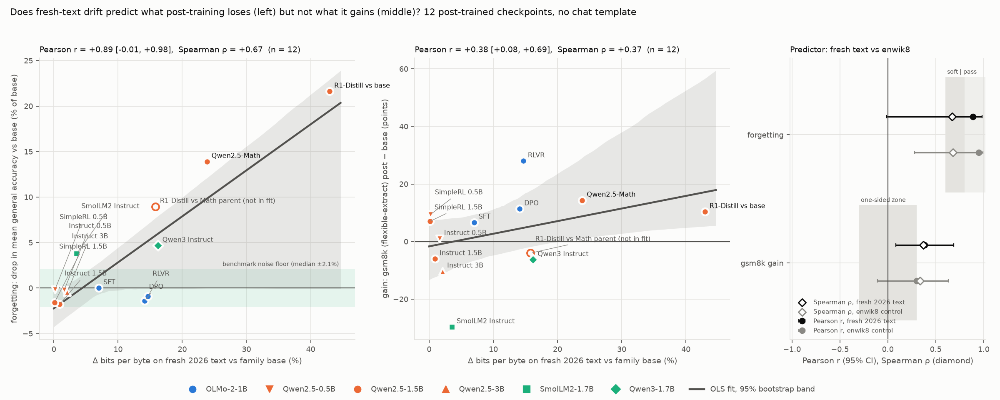

# exp04: does fresh-text drift predict benchmark forgetting, but not gain?

Run 2026-10-14 on AAU. Job 1080344 was an 18-task array on NVIDIA A10s (commit 9f22ff0), 22:20–23:58 CEST: 6.2 GPU-hours, no failed task or group. lm-evaluation-harness 0.4.13, transformers 5.19.0, torch 2.9.0a0 (NGC 25.09), datasets 5.1.0. Every number below is in `results/summary.md`, written by `analyze_forgetting.py` (`bash run_all.sh analyze`). The rules were committed before any job ran and are reproduced unchanged under the line at the end.

## Verdict

**Gate 1 passes as written, but on leverage. What fresh-text drift actually shows is a threshold, not a ranking.**

- **Pearson r(Δbpb_fresh, forgetting) = 0.89** [−0.01, 0.98], n = 12, which passes the pre-registered gate (≥ 0.8).
  - Two math-line checkpoints carry it: Qwen2.5-Math-1.5B (Δbpb +23.8%, general −13.9%) and R1-Distill-Qwen-1.5B (+43.0%, −21.6%).
  - Spearman ρ = 0.67 [0.06, 0.96], a soft pass on the same thresholds.
  - Without those two points, r = 0.32 and ρ = 0.43 (n = 10): a fail.
  - **I believe the Spearman and threshold readings, not the Pearson pass.**
- **Threshold reading** (not pre-registered).
  - 8 of 12 checkpoints are inside their benchmark noise floor (about ±2.1% of the base score), including OLMo-2 DPO and RLVR at Δbpb +14–15%.
  - All 3 checkpoints above +14.7% are outside it: Qwen3-1.7B at +16.2% (−4.7%), Qwen2.5-Math at +23.8% (−13.9%) and R1-Distill at +43.0% (−21.6%).
  - The exception is SmolLM2-1.7B-Instruct, which loses 3.8% at only +3.6% drift, nearly all of it on ARC (ARC-Easy −10.6 points).
  - So large drift does come with real forgetting, but below about 15% the meter does not rank checkpoints. The recipe matters more than the size of the drift (see "Recipe is the missing variable").
- **One-sidedness: not shown, and not testable with this gain measure.**
  - Under base prompting, r(Δbpb_fresh, gsm8k gain) = +0.38 [0.08, 0.69], so the pre-registered rule fails.
  - But gsm8k and ifeval under base prompting are **invalid as gain measures for chat-tuned checkpoints**. SmolLM2-Instruct scores 0.0 on gsm8k. Qwen2.5-3B-Instruct's strict-match falls from 71.3 to 17.0 because it stops writing "#### ". Several Instruct models score *below* their base.
  - These are format failures, not capability numbers. The gain side is re-run in the chat condition (addendum below).
- **enwik8 is at least as good a predictor** (E3 met): r = 0.95 and ρ = 0.68. Freshness of the text adds nothing to this outcome.
- **R1-Distill is not "big drift, modest loss"** (E4 not met). It loses the most of all 12 (−13.6 points of mean accuracy) and sits 2.1 points *above* the fitted line.
  - Against its parent Qwen2.5-Math, it drifts +15.8% and loses 9.0%: the distillation step itself also forgets.

`results/fig_forgetting.png`:
- **Left:** forgetting against Δbpb_fresh for the 12 checkpoints. It shows the OLS fit with a 95% checkpoint-bootstrap band, the median noise floor as a shaded strip, and R1-Distill against its Math parent as a hollow point (not in the fit).
- **Middle:** the pre-registered gsm8k gain under base prompting (see the validity note above).
- **Right:** Pearson r with 95% CIs and Spearman ρ for the fresh and enwik8 predictors.

## Rules and expectations against the outcome

| rule (pre-registered) | test | observed | verdict |
|---|---|---|---|
| Gate 1 | Pearson r(Δbpb_fresh, forgetting) ≥ 0.8 pass, ≥ 0.6 soft | r = 0.887 [−0.01, 0.98] | **pass** (on leverage, see below) |
| One-sidedness | \|r(Δbpb_fresh, gsm8k gain)\| < 0.3 and Gate 1 ≥ soft | r = +0.383 [0.08, 0.69] | **not shown** (gain measure invalid for chat models) |
| E1 | 0.6 ≤ r < 0.8 | 0.887 | not met (higher) |
| E2 | r(fresh, gain) < 0.3 | +0.383 | not met |
| E3 | r(enwik8, forgetting) ≥ r(fresh, forgetting) − 0.05 | 0.949 vs 0.887 | **met** |
| E4 | R1-Distill largest Δbpb and below the line | largest, but +2.1 points above the line | not met |

| reading (not pre-registered, added after an interim look) | observed | on the Gate 1 thresholds |
|---|---|---|
| Spearman ρ(Δbpb_fresh, forgetting), n = 12 | 0.671 [0.06, 0.96] | soft pass |
| Pearson without Qwen2.5-Math and R1-Distill, n = 10 | r = 0.317 [−0.45, 0.88], ρ = 0.430 | fail |
| R1-Distill measured against its Math parent instead of the plain base, n = 12 | r = 0.723 [−0.01, 0.96], ρ = 0.664 | soft pass |
| leave-one-out range of Pearson r, n = 12 | 0.69 (without R1-Distill) to 0.93; all others 0.88 or more | pass in 11 of 12 leave-outs, soft pass without R1-Distill |

The bootstrap CI of Pearson r reaches −0.01 because resamples that omit both math points have almost no spread in forgetting. The interval is honest: with n = 12, the gate's pass rests on two checkpoints.

## Per-checkpoint outcome

| family | stage | Δbpb fresh % | Δbpb enwik8 % | general (base → post) | forgetting % (floor ±) | gsm8k gain pts (base prompting) | ifeval gain pts |
|---|---|---|---|---|---|---|---|
| olmo2-1b | SFT | +6.99 | +9.35 | 58.89 → 58.88 | +0.0 (2.2) | +6.7 | +9.5 |
| olmo2-1b | DPO | +14.10 | +19.23 | 58.89 → 59.71 | −1.4 (2.2) | +11.3 | +32.0 |
| olmo2-1b | RLVR | +14.66 | +19.66 | 58.89 → 59.41 | −0.9 (2.2) | +28.0 | +30.0 |
| qwen2.5-0.5b | Instruct | +1.61 | +2.76 | 52.74 → 52.85 | −0.2 (2.5) | +1.0 | +4.5 |
| qwen2.5-0.5b | SimpleRL-Zoo | +0.18 | +0.40 | 52.74 → 52.82 | −0.1 (2.5) | +9.3 | +1.5 |
| qwen2.5-1.5b | Instruct | +0.91 | +1.58 | 62.69 → 63.81 | −1.8 (2.1) | −6.0 | +7.5 |
| qwen2.5-1.5b | SimpleRL-Zoo | +0.12 | +0.28 | 62.69 → 63.67 | −1.6 (2.1) | +7.0 | +1.0 |
| qwen2.5-1.5b | Qwen2.5-Math | +23.84 | +58.72 | 62.69 → 53.97 | **+13.9** (2.1) | +14.3 | −9.5 |
| qwen2.5-1.5b | R1-Distill | +42.95 | +74.30 | 62.69 → 49.14 | **+21.6** (2.1) | +10.3 | −6.5 |
| qwen2.5-3b | Instruct | +2.08 | +6.18 | 66.27 → 66.56 | −0.4 (1.9) | −10.3 | +20.5 |
| smollm2 | Instruct | +3.57 | +12.51 | 62.68 → 60.30 | **+3.8** (2.1) | −29.7 | −8.5 |
| qwen3 | Instruct | +16.18 | +24.93 | 62.54 → 59.62 | **+4.7** (2.1) | −6.3 | −8.0 |
| *qwen2.5-1.5b* | *R1-Distill vs Math parent* | *+15.81* | *+9.81* | *53.97 → 49.14* | ***+9.0*** *(2.1)* | *−4.0* | *+3.0* |

How to read the table:
- **general** is the mean of the 6 primary accuracies, in %; **forgetting** is the relative drop, and positive means a loss.
- Bold marks forgetting outside the noise floor. The floor is 1.96 × √(SE_post² + SE_base²) of the 6-task means from lm-eval's standard errors, as a percent of the base. It treats the two models as independent and so is a little conservative.
- The last row is the same R1-Distill model measured against its parent; it is not one of the 12.
- Chance-adjusted forgetting (the aggregate form of Harmon et al.'s adjustment) ranks the 12 identically, with r = 0.89.
- Raw per-task scores for all 18 checkpoints are in `results/summary.md` and `results/scores.csv`.

**Where the losses are.**
- The two math-line models lose on every task: Qwen2.5-Math has MMLU −16.9 and HellaSwag −10.5; R1-Distill has MMLU −23.2 and ARC-Easy −15.5.
- Qwen3-1.7B loses broadly but mildly: MMLU −5.9, HellaSwag −4.2, PIQA −3.5.
- SmolLM2-Instruct loses almost only on ARC (Easy −10.6, Challenge −3.8) and gains on WinoGrande (+2.0).
- OLMo-2 SFT/DPO/RLVR trade ARC-Easy (−2.6 to −3.6) against MMLU (+3.9 to +5.9) and HellaSwag (up to +3.0), for a net of zero.

**Within families.**
- OLMo-2 (3 points): the slope is *negative*, at −0.15% forgetting per Δbpb % (r = −0.91, all within noise). More drift comes with slightly less loss.
- Qwen2.5-1.5B (4 points): the slope is +0.56% per Δbpb % (r = 0.99), entirely because of the Math and R1 points.

## Recipe is the missing variable

Two SFT+DPO recipes land on opposite sides of the meter:
- **OLMo-2-1B: Tülu 3 SFT mix, then on-policy DPO.** Drifts +14.1% and loses nothing.
- **SmolLM2-1.7B: SmolTalk SFT, then UltraFeedback DPO.** Drifts +3.6% and loses 3.8%.

Δbpb measures how far the output distribution moved on general text. It does not measure whether the moved-to distribution still supports zero-shot multiple-choice scoring.

Plausible reasons, untested here:
- Tülu 3's SFT mix carries a lot of QA and knowledge data (FLAN-style tasks, among others), and OLMo-2's base was already mid-trained on instruction-like Dolmino data.
- SmolTalk is conversational.

The data tie the size of forgetting to *what* was trained, at least as much as to how far the model moved. The meter is a coarse alarm (Δbpb above ~15% was always followed by forgetting in this set), not a fine-grained predictor.

## Gain side under base prompting (pre-registered measure, invalid for chat models)

- **Pre-registered gain:** r(Δbpb_fresh, gsm8k flexible gain) = +0.38 [0.08, 0.69] and ρ = 0.37.
  - Without the 5 instruct-stage checkpoints (n = 7): r = 0.19 and ρ = 0.64.
  - Strict-match gain: r = +0.51.
  - ifeval gain: r = −0.21 over all 12 and +0.28 over the 8 chat-style checkpoints.
- **None of these can carry the one-sidedness claim.** Every model, chat-tuned or not, saw the same 5-shot "Question: … Answer:" prompt without its chat template, and gsm8k generation was capped at lm-eval's default 256 new tokens. This produced format failures in the chat models:
  - SmolLM2-Instruct: gsm8k 0.0;
  - Qwen2.5-3B-Instruct: strict-match 17.0 against flexible 65.7;
  - Qwen2.5-1.5B-Instruct: 54.3 against its base's 60.3;
  - Qwen3: 66.7 against 73.0.
- The cap also truncates long chains of thought (R1-Distill; SimpleRL-Zoo writes longer solutions too). The positive r comes mostly from the math-line models, whose gsm8k gains are real (Qwen2.5-Math +14.3, R1 +10.3).
- The addendum re-measures the post-trained side with each model's chat template.

## Cost: benchmark pass vs drift score (measured)

- **Benchmarks:** per checkpoint, the three groups took a median **18.2 min** on an A10, excluding about 2.5 min of job setup.
  - 0.5B: 14–15 min. 1.5B: 21 min. 3B: 37–39 min.
  - Per group, for Qwen2.5-0.5B (A10 dry run 1080328): log-likelihood 126 s, gsm8k 201 s, ifeval 577 s.
  - The array reproduced the dry run's scores exactly, with loglik in 93 s.
- **Drift score:** scoring the 3 fresh corpora (about 300 KB) took a median **19 s** per model on exp03's T4 (10–33 s).
- **Ratio:** the median is **67×**, and it is a lower bound on equal hardware, because the T4 is the slower card. For the 4 models scored on the Mac in exp01 (MPS), the ratio is 9–24×.

## Method as run, and deviations from the brief

- **Checkpoints, tasks, limits, metrics and statistics** are as pre-registered (below).
- **Per-task limits** were passed as `samples` (doc indices 0..N−1, identical to `--limit N`). Verified in the outputs: hellaswag 2,000 of 10,042; 40 in each of the 57 MMLU subjects; gsm8k 300; ifeval 200.
- **Harness versions:** arc_easy, arc_challenge, hellaswag, piqa and winogrande v1.0, 0-shot; mmlu group v2 (subtasks v1.0), 0-shot; gsm8k v3.0, 5-shot; ifeval v4.0, 0-shot. Seeds 0/1234/1234/1234. The full pip freeze is in `logs/setup/pip_freeze.txt`.
- **One process per checkpoint, not one lm_eval CLI process per group.**
  - The T4 dry run (job 1080307) spent about 6.5 min per CLI call indexing all lm-eval task YAMLs over the network file system, with the GPU idle.
  - The driver calls `simple_evaluate` once per group, over a TaskManager restricted to the 7 task directories. Each group has its own try/except, so failure isolation is kept.
- **Neutral generation config.**
  - transformers 5 let Qwen's `generation_config.json` (`max_new_tokens: 2048`) override lm-eval's 256-token gsm8k limit in the first dry run, at 6–9 s per item. Instruct checkpoints also ship sampling defaults (Qwen2.5-0.5B-Instruct: temperature 0.7, top_p 0.8, top_k 20, repetition_penalty 1.1).
  - The driver keeps only token ids, so every model decodes greedily at the harness defaults: 256 new tokens for gsm8k (the task sets none) and 1,280 for ifeval (a task setting). The dropped fields are listed per model in `summary.json`.
  - That dry run was cancelled at 27 min and its generative numbers are void. Its loglik scores agree with the A10 run to within 1–2 items per task.
- **GPU pinned to A10** (`--gres=gpu:a10:1`), so all 18 checkpoints ran the same fp16 kernels. On 2026-10-14 three A10 nodes were idle while L40S had 66 jobs pending.
- **lm-eval 0.4.13's CLI has no `--version` flag.** The setup job printed `lm_eval.__version__` instead.
- **Correction:** the pre-registration says "9 checkpoints" for the chat-style ifeval subset; the stage rule (sft/dpo/rlvr/instruct) gives 8.
- **Harmon et al.'s sample-wise forgetting metric** was not computed, because samples were not logged. The aggregate chance-adjusted drop is reported and ranks checkpoints identically.

## Failures

- No array task or group failed.
- The first dry run (1080307, T4) was cancelled because of the generation-config bug; it is the reason for the two driver changes above.
- The setup job used 28.5 of its 30 minutes: pip took about 21 min on the network file system (21:02 to 21:24), and the dataset and nltk prefetch about 7 min.

## Next steps

1. **Chat-condition gain (running as the addendum).** Re-score gsm8k and ifeval for the 12 post-trained checkpoints with their chat templates and multi-turn few-shot; that becomes the primary gain measure.
2. **Recipe-controlled drift.** The thread's step 1 (own fine-tunes of one base with SFT-chat, SFT-CoT, DPO and GRPO at 5 checkpoints each) is now the only way to separate "how far" from "what was trained". Public checkpoints confound the two.
3. **Report the meter as a threshold alarm.** Report the fraction of checkpoints above a Δbpb cut that forget beyond noise (here 3 of 3 above +15%, and 1 of 9 below it), with a recipe-held-out test, rather than as a correlation.
4. **Drop "fresh" from the claim for this outcome.** enwik8 predicts at least as well (r = 0.95, ρ = 0.68).

---

*Everything below this line is the pre-registration as committed before the jobs ran (abc08d9, with the scoring thresholds of f33fa18 and the decoding notes of 9f22ff0, all committed before any benchmark result existed). It is not edited.*

**Status: pre-registered, no results yet.** Everything below was written and committed before the AAU jobs ran. The outcome sections are added after the run, above this text; the rules are not edited.

## Question

exp01 and exp03 measured Δbpb, the fresh-text bits-per-byte drift of each post-trained checkpoint from its family base. Does that drift predict how much general capability the checkpoint lost (forgetting), while being unrelated to what it gained on the target task (one-sidedness)? This decides the thesis in `docs/research-thread.md` (chain steps 1 and 2).

## Checkpoints

All 18 rows of `cilab/stages.py` (`STAGES`): 6 family bases and 12 post-trained checkpoints. Array index = row.

| family | base | post-trained checkpoints (stage) |
|---|---|---|
| olmo2-1b | OLMo-2-0425-1B | -SFT (sft), -DPO (dpo), -Instruct (rlvr) |
| qwen2.5-0.5b | Qwen2.5-0.5B | -Instruct (instruct), SimpleRL-Zoo (rl-zero) |
| qwen2.5-1.5b | Qwen2.5-1.5B | -Instruct (instruct), SimpleRL-Zoo (rl-zero), Qwen2.5-Math-1.5B (math-cpt), R1-Distill-Qwen-1.5B (r1-distill) |
| qwen2.5-3b | Qwen2.5-3B | -Instruct (instruct) |
| smollm2 | SmolLM2-1.7B | -Instruct (instruct) |
| qwen3 | Qwen3-1.7B-Base | Qwen3-1.7B (instruct) |

Every post-trained checkpoint is compared with its **family base** (R1-Distill and Qwen2.5-Math with plain Qwen2.5-1.5B), the same reference as the predictor.

## Benchmarks (AAU, `infra/slurm/exp04_eval.sbatch`, driver `run_eval.py`)

- lm-evaluation-harness 0.4.13 (pinned in `infra/cluster/requirements-exp04.txt`), HF backend, fp16, `batch_size auto`, `max_length 2048`, `--seed 0,1234,1234,1234`, greedy decoding (task defaults), no `--log_samples`.
- **Decoding is the harness's greedy default for every model.** transformers 5 merges each checkpoint's `generation_config.json` into `generate()`; Qwen's sets `max_new_tokens: 2048`, which overrode lm-eval's 256-token gsm8k limit in the first dry run (job 1080307, cancelled), and instruct checkpoints also ship sampling and repetition-penalty defaults. The driver replaces the generation config with one holding only the token ids (the dropped fields are recorded per model in `summary.json`). gsm8k therefore generates at most 256 new tokens (lm-eval's default; the task sets no `max_gen_toks`) and ifeval at most 1,280 (task setting).
- **One GPU type for all checkpoints:** the array job pins `--gres=gpu:a10:1`, so fp16 kernels are the same for every model.
- **No chat template for any model.** Base and post-trained checkpoints see byte-identical prompts. This favours base models on generative tasks and is a stated confound, not a hidden one.
- General side (log-likelihood, harness default few-shot = 0 for all six): arc_easy (test, 2,376), arc_challenge (test, 1,172), hellaswag (first 2,000 validation docs), piqa (validation, 1,838), winogrande (validation, 1,267), mmlu (first 40 test questions of each of 57 subjects = 2,280).
- Target side (generative): gsm8k 5-shot (task default), first 300 test problems, strict-match and flexible-extract both recorded; ifeval 0-shot, first 200 prompts (installed via `lm-eval[ifeval]`).
- 11,433 documents per checkpoint. Per-task limits are passed to the single log-likelihood call as `--samples` (doc indices 0..N−1, which is exactly what `--limit N` selects), because `--limit` is global to a call.
- One `lm_eval.simple_evaluate` call per task group (log-likelihood, gsm8k, ifeval), in one process per checkpoint with the model loaded once; a failed group does not stop the others and the array task exits non-zero. (The dry run used one CLI process per group; that spent ~6.5 min per call indexing every lm-eval task YAML with the GPU idle, so the driver now indexes only the 7 task directories it uses.)

## Definitions (fixed before the run)

- **Primary accuracy per general task:** `acc_norm` where the task reports it (arc_easy, arc_challenge, hellaswag, piqa), else `acc` (winogrande, mmlu).
- **General score** = mean of the 6 primary accuracies.
- **Forgetting** (headline) = 100 × (general_base − general_post) / general_base, in percent of the base score; positive = capability lost.
- **Forgetting, chance-adjusted** (secondary) = the same relative drop on the mean of chance-adjusted accuracies (acc − c) / (1 − c), with c = 0.5 for piqa and winogrande and 0.25 for the other four (ARC has a few 3- and 5-choice items; 0.25 is used for all). Harmon et al. (2510.17776) use a chance-adjusted, *sample-wise* forgetting metric; it needs per-sample outcomes, which this run does not log (`--log_samples` off), so we cite it and report the aggregate chance-adjusted drop instead.
- **Gain** (headline) = gsm8k flexible-extract exact match, post − base, in points. Secondary: strict-match, and ifeval `prompt_level_strict_acc` (post − base) for the chat-style checkpoints.
- **Predictors** (vs the family base, RAW condition, point estimates):
  - Δbpb_fresh = mean over wiki2026, arxiv2026, gutenberg2026 of 100 × (Σ bits_post − Σ bits_base) / Σ bits_base;
  - Δbpb_enwik8 = the same on the enwik8 control.
  - 10 checkpoints from `exp03_staged_drift/results/stage_deltas.csv` (AAU T4, `kind == vs_base`); SmolLM2-Instruct and Qwen3-1.7B from `exp01_posttraining_bpc/results/bpb.csv` (Mac MPS). Mixing is fine: exp03 reproduced exp01's 4 shared models on the T4 within 5e-5 bpb.
- **Statistics** (`analyze_forgetting.py`, over the 12 post-trained checkpoints): Pearson r (the gate statistic) and Spearman ρ of each predictor with each outcome; 95% percentile CIs from 10,000 bootstrap resamples of checkpoints (seed 0; resamples with a constant column are dropped); leave-one-out range of r; within-family OLS slopes for OLMo-2-1B (3 post-trained points) and Qwen2.5-1.5B (4 points). n = 12 is small and the CIs will be wide.

## Pre-registered rules

| rule | statistic | pass | soft pass | fail |
|---|---|---|---|---|
| **Gate 1**: drift predicts forgetting | Pearson r(Δbpb_fresh, forgetting), n = 12 | r ≥ 0.8 | 0.6 ≤ r < 0.8 | r < 0.6 |
| **One-sidedness**: drift does not predict gain | Pearson r(Δbpb_fresh, gsm8k gain) | holds if \|r\| < 0.3 **and** Gate 1 at least soft-passes | | otherwise not shown |

**Expected** (stated now, scored after):
- E1: r(Δbpb_fresh, forgetting) between 0.6 and 0.8 (soft pass).
- E2: r(Δbpb_fresh, gsm8k gain) near 0 or negative.
- E3: the enwik8 predictor does as well as or slightly better than fresh text (exp03: the control drifts 1.3–3× more).
- E4: R1-Distill has the largest drift (+43% vs Qwen2.5-1.5B) but only modest general loss, i.e. it sits below the fitted line.

How each expectation is scored (added 2026-10-14 in a separate commit, before any benchmark result existed; Pearson r throughout):
- E1 met if 0.6 ≤ r(Δbpb_fresh, forgetting) < 0.8.
- E2 met if r(Δbpb_fresh, gsm8k gain) < 0.3 (near zero or negative).
- E3 met if r(Δbpb_enwik8, forgetting) ≥ r(Δbpb_fresh, forgetting) − 0.05.
- E4 met if R1-Distill has the largest Δbpb_fresh of the 12 and a negative residual from the OLS line of forgetting on Δbpb_fresh fitted to all 12.
- "Chat-style" for the ifeval gain = stages sft, dpo, rlvr and instruct (9 checkpoints); ifeval gain is also reported over all 12.

## Confounds (stated before the run)

- **Prompt format.** No chat template anywhere. Chat-tuned and reasoning models (Qwen3, R1-Distill) are scored off their native format, which lowers their generative scores (gsm8k, and ifeval in particular) and can look like forgetting on log-likelihood tasks. This is the price of identical prompting.
- **Generation length.** gsm8k uses lm-eval's default cap of 256 new tokens for every model. Long chain-of-thought models (R1-Distill above all, and possibly SimpleRL-Zoo) can be cut off before their final answer, which understates their gsm8k gain. This is the cost of identical decoding; it is not corrected.
- **Subsets.** hellaswag 2,000 of 10,042; mmlu 40 per subject; gsm8k 300 of 1,319; ifeval 200 of 541. The binomial standard error of gsm8k at n = 300 is about ±2.8 points.
- **n = 12 checkpoints from different labs and recipes**, with family as a nuisance factor; two points (Qwen2.5-Math, R1-Distill) are continued pretraining and distillation on math, far from the others in Δbpb, and will carry leverage in Pearson r. Spearman and leave-one-out are reported for this reason.
- **Contamination.** Public benchmarks (gsm8k, mmlu, arc) may be in some post-training sets, inflating "gain" and masking "forgetting" unevenly across recipes.
- **Hardware.** All array tasks request an A10; the GPU is recorded per checkpoint. exp03's predictors came from a T4 (and exp01's from the Mac); benchmark and bpb hardware differ by design.
