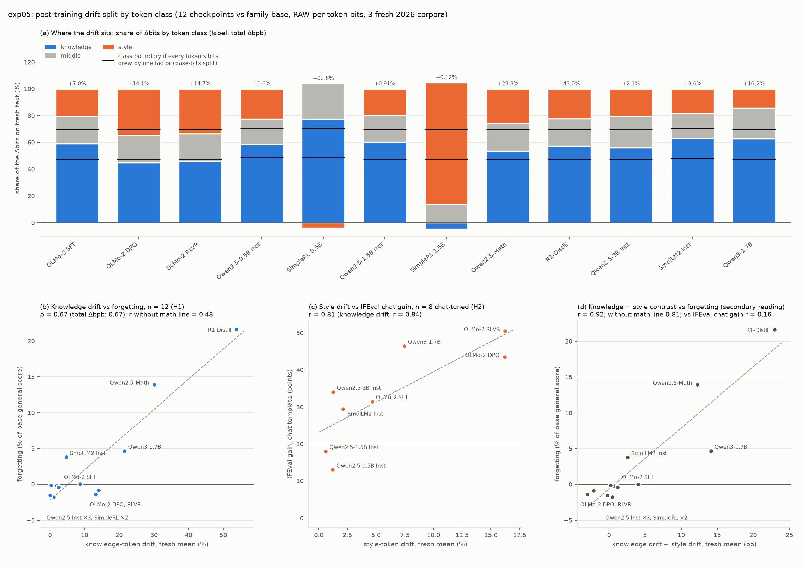

# exp05: does post-training drift sit on knowledge tokens or on style tokens?

Run 2026-10-15 on the Mac (CPU only, no new scoring), `bash run_all.sh`: the align step takes 23 s and analyze 45 s. The definitions, tests and expectations were committed in 1eb436a, before any class-level drift existed, and are reproduced unchanged under the line at the end. Every number below is in `results/summary.md`, `results/decomposition.csv` or `results/correlations.csv`, all written by `analyze_decomposition.py`.

## Verdict

**The pre-registered fail rule triggers: at this scale, drift is one-dimensional.** Across the 12 checkpoints, knowledge-token drift and style-token drift correlate at r = 0.925 [0.72, 1.00] (ρ = 0.97), above the 0.9 fail line. Whatever a recipe does, names, numbers and rare words move together with function words, punctuation and whitespace. The size of the move (the dose) dominates both outcomes. Neither channel test passes.

- **H1 fails.**
  - Knowledge drift ranks the 12 checkpoints exactly as total drift does: ρ = 0.671 against 0.671.
  - Without the math line, r = 0.48 [−0.39, 0.90]. Total drift gave 0.32, and the bar was 0.6.
  - That 0.48 rests on Qwen3; without it, r = −0.04.
- **H2 fails.**
  - Style drift does track the IFEval chat gain: r = 0.805 [0.62, 0.96], just above the 0.8 bar.
  - But knowledge drift tracks it as well, r = 0.844, where the test needed < 0.5.
- **H3 passes.**
  - SmolLM2-Instruct puts 63.0% [60.1, 66.2] of its fresh-text Δbits on knowledge tokens; OLMo-2 DPO puts 44.7% [42.6, 46.8]. The difference is +18.3 pp [+14.6, +22.1].
  - It holds on each fresh corpus (wiki 75 vs 52, arXiv 69 vs 52, Gutenberg 45 vs 31) but not on the enwik8 control (51.1 vs 51.4).
- **H4 passes as written, but weakly.**
  - ρ(excess, MMLU loss) = 0.42 [−0.28, 0.81] against ρ(Δbpb_fresh, MMLU loss) = 0.34 [−0.46, 0.86]; both CIs span zero.
  - Without the math line, excess gives ρ = 0.01. Read this as no evidence either way.
- **Expectations.** E1 (the fail rule triggers) and E2 (the knowledge/style ordering for Math, R1, SmolLM2 and OLMo-2 DPO) are both met.

**What the decomposition does show: the direction of the drift carries a forgetting signal that its size does not. This is the one-sided pattern exp04 looked for.** This is a pre-registered secondary reading with no threshold, so it is a lead, not a result.
- **The contrast tracks forgetting.** The contrast is drift_KNOWLEDGE − drift_STYLE.
  - Over all 12: r = 0.92 [0.65, 0.99], ρ = 0.85 [0.47, 0.97].
  - **Without the math line: r = 0.81 [0.41, 0.98], ρ = 0.76** [0.16, 0.96], against 0.32 and 0.43 for total drift.
- **It does not track the IFEval chat gain:** r = 0.17 [−0.88, 0.90], ρ = −0.07, n = 8. Total drift gives 0.89 there.
- **The frequency-only split replicates it without a POS tagger.** Rare minus frequent gives r = 0.82 for forgetting (0.74 without the math line), and r = −0.07 for the gain.
- **The cleanest case is two checkpoints at the same dose.**
  - OLMo-2 DPO drifts +14.1% in total, and its style tokens drift more than its knowledge tokens (K − S = −3.0 pp). Among checkpoints above a trivial dose, only it and the RLVR model trained on top of it show this. It forgets nothing (−1.4%).
  - Qwen3-1.7B drifts +16.2% with K − S = +14.1 pp, and forgets 4.7%.
- **Caveats.**
  - The leave-one-out minimum without the math line is 0.55, with Qwen3 removed.
  - The scale-free form, share_KNOWLEDGE, does not carry it (r = 0.17, n = 12). Partly that is because shares are noise for the two SimpleRL checkpoints, whose total Δ is only 0.1–0.2%.
  - The signal needs its own pre-registered test on recipe-controlled checkpoints.

`results/fig_decomposition.png`:
- **(a)** For each checkpoint, the share of its fresh-text Δbits on knowledge, middle and style tokens. The black ticks mark where the class boundaries would sit if every token's bits grew by one factor (the base-bits split), and the labels give total Δbpb.
- **(b)** Knowledge drift against forgetting (H1).
- **(c)** Style drift against the IFEval chat gain for the 8 chat-tuned checkpoints (H2).
- **(d)** The knowledge − style contrast against forgetting (the secondary reading).

## Pre-registered tests against the outcome

| id | rule | observed | verdict |
|---|---|---|---|
| fail rule | r(drift_K, drift_S) over 12 > 0.9 | r = 0.925 [0.72, 1.00]; ρ = 0.972; without the math line r = 0.76 (ρ = 0.95); chat-tuned r = 0.71 (ρ = 0.93) | **triggered**: drift is one-dimensional |
| H1 | ρ(drift_K, forgetting) ≥ ρ(Δbpb_fresh, forgetting) **and** r without the math line ≥ 0.6 | ρ = 0.671 vs 0.671; r(n = 10) = 0.480 | fail |
| H2 | r(drift_S, IFEval chat gain) ≥ 0.8 **and** r(drift_K, gain) < 0.5, n = 8 | 0.805 and 0.844 | fail |
| H3 | share_K CI of SmolLM2-Instruct above OLMo-2-DPO's | 63.0 [60.1, 66.2] vs 44.7 [42.6, 46.8] | pass |
| H4 | ρ(excess, MMLU loss) ≥ ρ(Δbpb_fresh, MMLU loss), n = 12 | 0.420 vs 0.336 (in points: 0.448 vs 0.357) | pass (weak, CIs span 0) |
| E1 | the fail rule triggers | r = 0.925 | met |
| E2 | K > S for Math, R1 and SmolLM2-Instruct; S ≥ K for OLMo-2 DPO | K/S = +30.1/+17.8, +53.8/+30.8, +4.7/+2.1; DPO +13.2/+16.2 | met |

| secondary reading (pre-registered, no threshold) | n | Pearson r [95% CI] | Spearman ρ | leave-one-out range of r |
|---|---|---|---|---|
| contrast K − S vs forgetting | 12 | 0.919 [0.65, 0.99] | 0.853 | 0.81 to 0.97 |
| contrast K − S vs forgetting, without the math line | 10 | 0.806 [0.41, 0.98] | 0.758 | 0.55 (without Qwen3) to 0.94 |
| contrast K − S vs IFEval chat gain, chat-tuned | 8 | 0.165 [−0.88, 0.90] | −0.071 | −0.50 to 0.42 |
| contrast rare − frequent vs forgetting | 12 / 10 | 0.818 / 0.736 | 0.853 / 0.758 | |
| contrast rare − frequent vs IFEval chat gain | 8 | −0.066 | −0.071 | |
| H1 / H2 / fail rule, frequency variant | | ρ 0.671 vs 0.671 and r(10) 0.478; r 0.802 and 0.843; r(rare, frequent) 0.911 | | fail / fail / triggered |
| total Δbpb_fresh vs forgetting (exp04 reference) | 12 / 10 | 0.887 / 0.317 | 0.671 / 0.430 | |

## Where the drift sits

The fresh mean, with 95% window-bootstrap CIs. **share** is the % of the checkpoint's total Δbits that falls on a class. The **null** is that class's % of the base model's bits, which is what the share would be if every token's bits grew by one factor. **drift** is the relative change in the class's bits.

| checkpoint | Δbpb fresh | share knowledge (null) | share middle (null) | share style (null) | drift knowledge | drift style | K − S (pp) | forgetting % | IFEval chat gain |
|---|---|---|---|---|---|---|---|---|---|
| OLMo-2 SFT | +6.99% | 58.9 [56.4, 61.5] (47.4) | 20.6 (22.2) | 20.5 [18.5, 22.5] (30.4) | +8.69% | +4.67% | +4.01 | +0.01 | +31.5 |
| OLMo-2 DPO | +14.10% | 44.7 [42.6, 46.8] (47.4) | 20.5 (22.2) | 34.8 [33.2, 36.4] (30.4) | +13.20% | +16.20% | −3.00 | −1.40 | +43.5 |
| OLMo-2 RLVR | +14.66% | 45.9 [43.8, 48.0] (47.4) | 20.6 (22.2) | 33.5 [32.0, 35.1] (30.4) | +14.10% | +16.23% | −2.13 | −0.88 | +50.5 |
| Qwen2.5-0.5B Inst | +1.61% | 58.5 [54.3, 62.8] (48.4) | 18.9 (22.2) | 22.6 [19.4, 25.6] (29.4) | +1.92% | +1.23% | +0.69 | −0.22 | +13.0 |
| SimpleRL 0.5B | +0.18% | 77.5 [67.5, 92.6] (48.4) | 26.6 (22.2) | −4.1 [−19.3, 5.0] (29.4) | +0.28% | +0.04% | +0.24 | −0.15 | +5.5 |
| Qwen2.5-1.5B Inst | +0.91% | 60.3 [54.5, 66.6] (47.3) | 19.8 (22.4) | 19.9 [14.9, 24.3] (30.3) | +1.09% | +0.62% | +0.48 | −1.78 | +18.0 |
| SimpleRL 1.5B | +0.12% | −4.7 [−45.9, 12.3] (47.3) | 13.8 (22.4) | 91.0 [73.0, 137.4] (30.3) | +0.02% | +0.28% | −0.26 | −1.57 | −6.0 |
| Qwen2.5-Math | +23.84% | 53.5 [51.1, 55.9] (47.3) | 20.6 (22.4) | 25.9 [24.2, 27.7] (30.3) | +30.06% | +17.83% | +12.23 | +13.90 | +1.5 |
| R1-Distill | +42.95% | 57.1 [55.2, 58.8] (47.3) | 20.5 (22.4) | 22.4 [21.2, 23.7] (30.3) | +53.76% | +30.80% | +22.96 | +21.61 | +5.5 |
| Qwen2.5-3B Inst | +2.08% | 55.8 [51.9, 60.2] (47.1) | 23.7 (22.3) | 20.5 [16.9, 23.6] (30.6) | +2.48% | +1.26% | +1.22 | −0.44 | +34.0 |
| SmolLM2 Inst | +3.57% | 63.0 [60.1, 66.2] (47.9) | 18.6 (22.6) | 18.4 [15.6, 20.8] (29.6) | +4.70% | +2.12% | +2.57 | +3.79 | +29.5 |
| Qwen3-1.7B | +16.18% | 62.6 [60.4, 64.9] (47.3) | 23.1 (22.4) | 14.4 [12.8, 15.9] (30.4) | +21.56% | +7.44% | +14.12 | +4.67 | +46.5 |

Forgetting and the IFEval chat gain are exp04's (`scores.csv`). The middle-class CIs and every corpus separately are in `results/summary.md`.

**Knowledge tokens pay first.**
- For 9 of the 12 checkpoints, the knowledge share sits above its null and the style share below it: the four Instruct models (Qwen2.5 at three sizes, SmolLM2), Qwen2.5-Math, R1-Distill, Qwen3, OLMo-2 SFT and the noisy SimpleRL 0.5B.
- The base-bits split is about 47 / 22 / 30%, while the classes hold about 40 / 16 / 43% of the tokens.

**Apart from the noisy SimpleRL 1.5B, only OLMo-2 DPO and RLVR invert the pattern.** Their style share is 34.8% and 33.5% against a null of 30.4%, and their knowledge share falls below its null. These are the two checkpoints that drift +14–15% yet forget nothing.

**SimpleRL shares are noise.** Their total Δ is 0.1–0.2%, so a share is a ratio of near-zero differences, with CIs about ±40 pp wide.

**Which POS tags carry it** (point estimates; % of the Δbits, with the null in brackets; table in `results/summary.md`):
- **OLMo-2 DPO** spreads its drift onto function words and whitespace: DET 7.3 (5.7), AUX 3.2 (2.4), whitespace-only tokens 2.4 (0.9).
- **Qwen3, SmolLM2-Instruct and Qwen2.5-Math** concentrate theirs on proper nouns: PROPN 23.5, 25.6 and 23.1 (15.0). For Qwen3, determiners even get cheaper (DET −1.0).

## Method as run

Exactly as pre-registered (below):
- **Code.** Helpers are in `cilab/tokclass.py` (alignment, classes, per-class sums), and the bootstrap statistic `cilab.stats.paired_share` sits next to `paired_pct_change`. Tests are in `tests/test_tokclass.py`: GPT-2 offset round-trip, class assignment on a hand-tagged sentence, and per-class sums equal to the total.
- **Pins.** spaCy 3.8.16 with `en_core_web_sm` 3.8.0 (tagger and attribute ruler), and wordfreq 3.1.1 `top_n_list("en", 2000)`. They are in `requirements.txt`, and `results/alignment.json` records the versions and a hash of the word list.
- **Alignment.** Checked on all **72 (model, corpus) pairs** (18 models × 4 corpora). Each check passed:
  - offsets-call ids equal `cilab.text.encode` and every model's own tokenizer;
  - the token count equals the saved bits length;
  - the window lengths equal exp03's `windows.csv`;
  - the ids' SHA-1 equals exp03's `bpb.csv`, and exp01's token counts match for SmolLM2 and Qwen3;
  - the offsets tile each corpus;
  - every token whose own decode is a whole string decodes to the text under its offsets. That is all tokens except 0–303 split-character pieces per corpus, out of 20,000–34,000.
- **Classes.** One tagging pass per corpus; classes once per tokenizer group (olmo2, qwen2.5, qwen3, smollm2).
- **Reproduction.** Drift over all tokens reproduces exp04's Δbpb_fresh and Δbpb_enwik8 for all 12 checkpoints, within 5e-6 percentage points (tolerance 1e-3).
- **Determinism.** Both steps are byte-identical on a rerun.

## Robustness

- **Frequency-only split.** Every verdict is the same: the fail rule triggers at r = 0.911, H1 and H2 fail, and the contrast replicates (above). Because this split needs no tagger, the tagger artefacts below cannot explain the result.
- **Per corpus.** The fresh-mean pattern holds on each fresh corpus. The knowledge share for SmolLM2-Instruct against OLMo-2 DPO is 75 vs 52 on wiki, 69 vs 52 on arXiv and 45 vs 31 on Gutenberg. On enwik8 the two are equal (51.1 vs 51.4).
- **MMLU loss in points instead of relative.** H4 gives 0.448 vs 0.357, the same verdict.
- **Pearson instead of Spearman for H1, n = 12.** Knowledge drift gives r = 0.924 against 0.887 for total drift, which is again total drift seen through a subset.

## Failures and deviations

- **Nothing failed to run.** All 72 alignment checks passed, and the reproduction check passed.
- **Tagger artefacts, left uncorrected because the definitions are pre-registered.**
  - spaCy tags arXiv LaTeX math (`$\Delta_i^e(t)$`) as PROPN, so it lands in KNOWLEDGE.
  - Hyphen-led BPE pieces (`-year`) take PUNCT from their first character.
  - The Qwen and SmolLM2 tokenizers split numbers into digits. On wiki2026, NUM is 17–18% of their KNOWLEDGE tokens, against 11% for OLMo-2.
  - The frequency variant, which is free of all three, gives the same verdicts.
- **Two thresholds were close.** H2's style correlation cleared 0.8 by 0.005, which does not matter because the knowledge clause failed by a wide margin. H1's ρ tied exactly, because knowledge drift and total drift give the same ranking.
- **Additions beyond the brief, both reporting only:** panel (d) of the figure (the secondary contrast reading) and a per-POS share table in `summary.md`.

## Next steps

1. **Pre-register the contrast as the forgetting meter on recipe-controlled fine-tunes** (thread step 1). Fix the meter as drift_rare − drift_frequent (no tagger needed), state a threshold before training, and predict that it tracks forgetting within one base and several recipes, while the IFEval gain does not track it. Here it is a post-hoc lead resting on about four informative checkpoints (Qwen3, SmolLM2, OLMo-2 DPO/RLVR) once the math line is set aside.
2. **Match the dose.** The contrast is in percentage points and grows with total drift, and the scale-free share form does not carry the signal on this set. A sweep with several checkpoints at matched Δbpb would separate direction from dose.
3. **Re-test the memorisation axis on the matched sweep.** H4 passed on a ρ difference of 0.08 with CIs spanning zero. Here, excess (enwik8 − fresh) is not informative beyond total drift.

---

*Everything below this line is the pre-registration as committed in 1eb436a, before any class-level drift existed. It is not edited.*

**Status: pre-registered, no results yet.** Everything below was written on 2026-10-15, before any per-class bits were summed and before any correlation was computed. The outcome sections are added above this text after the run; the definitions and rules are not edited.

## Question

exp04 found that fresh-text Δbpb tracks both forgetting (ρ = 0.67, n = 12) and the IFEval chat gain (r = 0.89, n = 8). One number cannot be a forgetting meter if it also measures what was gained. Does the drift split into two channels?
- A **knowledge** channel: bits on names, numbers and rare content words, which should rise when a recipe overwrites what the model knows (math continued pretraining, R1 distillation, SmolLM2's SmolTalk SFT).
- A **behaviour** channel: bits on function words, punctuation and whitespace, which should rise when a recipe changes how the model writes (chat SFT, DPO, RLVR).

The test: knowledge drift should predict forgetting, and style drift should predict the instruction-following gain.

## Data (no new scoring; Mac only)

- **Per-token bits, RAW condition** (−log2 p of every text token, input = [doc-start, *window], 1024-token windows):
  - exp03 `results/tokens/`: 14 models × 4 corpora (AAU T4, fp16).
  - exp01 `results/tokens/`, `raw` rows only: SmolLM2-1.7B, SmolLM2-1.7B-Instruct, Qwen3-1.7B-Base, Qwen3-1.7B (Mac MPS, fp16).
  - 18 models × 4 corpora = 72 (model, corpus) arrays.
- **Corpora:** exp01's dated snapshots, whole files as scored: wiki2026, arxiv2026, gutenberg2026 (fresh) and enwik8_ctrl.
- **Outcomes:** exp04 `results/scores.csv`, definitions unchanged.
- **Checkpoints:** the 12 post-trained rows of `cilab/stages.py`, each against its family base. Qwen2.5-Math-1.5B and R1-Distill are compared with plain Qwen2.5-1.5B, as in exp04.

## Alignment (fixed now)

- **Token ids and character offsets.** The fast tokenizer is called on exactly the scored text: `tok(text, add_special_tokens=False, return_offsets_mapping=True)`.
- **The run raises unless:**
  - the ids equal `cilab.text.encode(tok, text)`;
  - the number of ids equals the length of the saved bits array, for every one of the 72 (model, corpus) pairs;
  - the windows from `cilab.text.make_windows(tok, ids, text, 1024)` cover those ids, and for exp03 models their lengths equal exp03's `windows.csv`;
  - for exp03 models, the ids' SHA-1 equals `ids_sha1` in exp03's `bpb.csv`, and for exp01 models, the token count equals exp01's `bpb.csv`;
  - each model's own tokenizer gives the same ids as the first model of its tokenizer group (`cilab.stages.tokenizer_groups`: olmo2, qwen2.5, qwen3, smollm2);
  - the offsets tile the text: the first span starts at 0, starts never decrease, no gap between a token and the next, the last span ends at the end of the text;
  - every token whose own decode is a whole string (no U+FFFD) decodes to exactly the text under its offsets.
- Classes are computed once per tokenizer group per corpus.
- **POS tags:** spaCy 3.8 `en_core_web_sm` 3.8.0, tagger and attribute ruler only (parser, NER and lemmatizer disabled), run once per corpus on the whole text.
- **Token → word:** each token takes the Universal POS tag (`pos_`) and the lowercased form (`lower_`) of the spaCy token covering the token's **first non-whitespace character**. A token made only of whitespace has no word.

## Token classes (primary definition)

| class | members |
|---|---|
| **KNOWLEDGE** | PROPN, NUM; NOUN, ADJ, VERB whose lowercased word is **not** among the 2,000 most frequent English words |
| **STYLE** | DET, ADP, PRON, CCONJ, SCONJ, AUX, PART, INTJ, PUNCT, SPACE, SYM, and whitespace-only tokens |
| **MIDDLE** | everything else: NOUN, ADJ, VERB among the 2,000 most frequent words; ADV; X |

- **Frequency list:** wordfreq 3.1.1, `top_n_list("en", 2000)` (Robyn Speer, 2022, rspeer/wordfreq v3.0, Zenodo, doi:10.5281/zenodo.7199437). Surface forms, not lemmas.
- All three classes are reported. The hypotheses are about KNOWLEDGE against STYLE.

**Robustness variant (secondary).** A frequency-only split per corpus and tokenizer group:
- each token occurrence gets f = the count of its token id in that corpus;
- **RARE** if f is below the median of f over all token occurrences of the corpus, else **FREQUENT**.
- RARE stands in for KNOWLEDGE and FREQUENT for STYLE.

## Quantities

All per post-trained checkpoint m, its family base b, corpus k and class c, from the RAW per-token bits:
- **drift_c** = 100 (Σ_c bits_m − Σ_c bits_b) / Σ_c bits_b, in %. This is the relative change of the class's code length.
- **share_c** = 100 (Σ_c bits_m − Σ_c bits_b) / (Σ_all bits_m − Σ_all bits_b), in % of the total Δbits. The three classes sum to 100. This shows where the drift sits.
- **Proportional null:** base_frac_c = 100 Σ_c bits_b / Σ_all bits_b. If post-training scaled every token's bits by one factor, share_c would equal base_frac_c. It is reported next to share_c.
- **Fresh value:** the unweighted mean over wiki2026, arxiv2026 and gutenberg2026, the same convention as Δbpb_fresh in exp03 and exp04.
- **CIs:**
  - paired window bootstrap, 5,000 resamples, seed 0 + corpus index (exp03's seeds, so the same resamples as exp03);
  - the fresh mean resamples windows within each corpus (`cilab.stats.stratified_mean_ci`);
  - the windows are the 1024-token `make_windows` windows.
- **Memorisation axis:** excess = Δbpb_enwik8 − Δbpb_fresh, in percentage points, over all tokens.
- **Reproduction check:** drift over all tokens must reproduce exp04's `dbpb_fresh` and `dbpb_enwik8` within 1e-3 percentage points. The run raises otherwise.

**Outcomes** (exp04 `scores.csv`):
- **forgetting** = 100 (general_base − general_post) / general_base, in % of the base;
- **IFEval chat gain** = `gain_ifeval_chat`, in points (the post-trained model with its chat template, minus its base, prompt-level strict);
- **MMLU loss** = 100 (mmlu_base − mmlu_post) / mmlu_base, in % of the base (relative, like forgetting). MMLU loss in points is reported as a reading.

**Statistics** follow exp04's conventions:
- Pearson r and Spearman ρ over checkpoints;
- 95% percentile CIs from 10,000 checkpoint-bootstrap resamples (seed 0; resamples with a constant column are dropped);
- leave-one-out range;
- "without the math line" = without Qwen2.5-Math-1.5B and R1-Distill (n = 10);
- "chat-tuned" = stages sft, dpo, rlvr, instruct (n = 8).

## Pre-registered tests

| id | statistic | passes if |
|---|---|---|
| **H1** knowledge channel | Spearman ρ(drift_KNOWLEDGE fresh, forgetting), n = 12; and Pearson r of the same pair without the math line, n = 10 | ρ ≥ ρ(Δbpb_fresh, forgetting) as recomputed here (exp04: 0.671) **and** r ≥ 0.6 without the math line (the total gave 0.32) |
| **H2** behaviour channel | Pearson r over the 8 chat-tuned checkpoints: drift_STYLE fresh vs IFEval chat gain, and drift_KNOWLEDGE fresh vs IFEval chat gain | r_style ≥ 0.8 **and** r_knowledge < 0.5 |
| **H3** case contrast | share_KNOWLEDGE fresh with its 95% CI, SmolLM2-1.7B-Instruct vs OLMo-2-0425-1B-DPO | the lower CI bound for SmolLM2-Instruct lies above the upper CI bound for OLMo-2-DPO |
| **H4** memorisation axis | Spearman ρ over the 12 | ρ(excess, MMLU loss) ≥ ρ(Δbpb_fresh, MMLU loss) |
| **Fail: one-dimensional drift** | Pearson r(drift_KNOWLEDGE fresh, drift_STYLE fresh) over the 12 | r > 0.9 |

**What "fail" means.** If knowledge and style drift correlate above 0.9 across the 12 checkpoints, all channels move together and drift is one-dimensional at this scale. In that case the decomposition adds no channel, whatever H1 and H2 say: a pass on either would be the total drift seen through a subset of tokens. If the fail rule does not trigger:
- H1 alone supports a knowledge channel;
- H2 alone supports a behaviour channel;
- both together support the two-channel reading.

**Secondary readings** (pre-registered here, not gates):
- **Contrast:** drift_KNOWLEDGE − drift_STYLE, in percentage points, against forgetting (n = 12 and n = 10) and against the IFEval chat gain (n = 8). A channel-specific signal survives one-dimensionality only if the contrast predicts.
- **Frequency variant:** H1 and H2 repeated with RARE in place of KNOWLEDGE and FREQUENT in place of STYLE, and the one-dimensional rule on RARE vs FREQUENT.
- **Full table:** drift_c and share_c for every class, checkpoint and corpus, plus the proportional null.
- **Other forms:** MMLU loss in points; Spearman for every test that is stated in Pearson, and the reverse.

**Expected** (stated now, scored after):
- **E1.** The fail rule triggers (r > 0.9), because Qwen2.5-Math and R1-Distill drift far on every class and dominate any Pearson over 12.
- **E2.** drift_KNOWLEDGE > drift_STYLE on the fresh mean for Qwen2.5-Math, R1-Distill and SmolLM2-Instruct, and drift_STYLE ≥ drift_KNOWLEDGE for OLMo-2 DPO.

## Confounds (stated before the run)

- **Tagger errors.** en_core_web_sm is a small model. arXiv abstracts carry LaTeX, Gutenberg has archaic spelling and enwik8 has wiki markup; POS tags there will be noisier than on news text.
- **First-character rule.** A BPE token that spans a word boundary (`",\n\n"`, `").`") takes the class of its first non-space character. Every continuation piece of a long rare word counts as KNOWLEDGE, so rare words weigh by their token count.
- **Tokenizers split differently.** Qwen tokenizers split numbers into single digits, so NUM carries more tokens in the Qwen families than in OLMo-2.
- **Surface forms.** The top-2,000 list is not lemmatised, so inflections of common verbs outside the list (for example "explained") land in KNOWLEDGE.
- **Relative vs absolute.** Style tokens are cheap (few bits each), so a small absolute change is a large relative drift_c. share_c is the absolute view; both are reported.
- **Small and heterogeneous n.** The 12 checkpoints come from different labs, recipes and families. The two math-line points carry leverage in any Pearson r.
- **Outcome noise.** The outcomes are exp04's single-run benchmark scores. 8 of 12 forgetting values are inside their noise floor.
