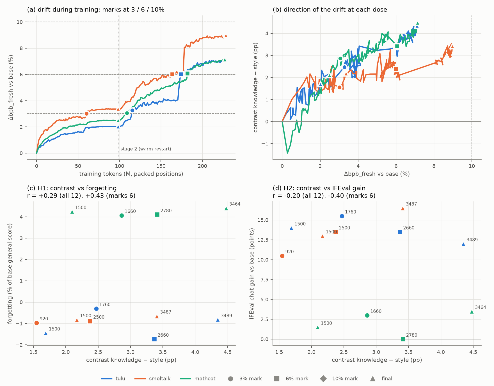

# exp06: at matched drift, does the knowledge − style contrast predict forgetting and ignore the gain?

Run 2026-10-15/16 on AAU. Training ran in two stages on 3 A40s: stage 1 took 6.5 h, then stage 2, a warm restart, took 8.6 h. 12 checkpoints and the base were benchmarked on A10s. The analysis is `bash run_all.sh analyze` (Mac, about 20 s); every number below is in `results/summary.md`, `results/checkpoints.csv` or `results/correlations.csv`. The pre-registration, its post-dry-run deviation, the stage-2 extension and the exploratory hypothesis are reproduced unchanged under the line at the end.

## Verdict

**The pre-registered fail rule triggers: under recipe control, the knowledge − style contrast does not predict forgetting.** exp05's lead is not supported.

- **Primary set: the 6 mark checkpoints**, 3 recipes × the 3% and 6% marks. The 10% mark was never reached.
  - **H1 fails.** r(contrast_ks, forgetting) = 0.43 [−0.79, 1.00]. Dropping one recipe at a time gives 0.86 / 0.12 / −0.53 (tulu / smoltalk / mathcot dropped).
  - **H2 fails.** r(contrast_ks, IFEval gain) = −0.41; it had to stay within ±0.3.
  - **H3 passes** at both reached marks. The forgetting range across recipes is 5.0 pp at 3% and 5.8 pp at 6%, against a noise floor of 2.2 pp.
  - **H4 fails.** At the 6% mark the contrast is mathcot 3.41 ≈ tulu 3.37 > smoltalk 2.38 pp, not the predicted mathcot > smoltalk > tulu.
- **The set the coordinator asked for: all 12 checkpoints**, marks plus finals. H1 r = 0.29 [−0.29, 0.78] (fail); H2 r = −0.20 (pass). The fail rule triggers again.

**What the run does show: at matched drift, the recipe decides forgetting, and neither total drift nor its direction tells the recipes apart.**

- **Forgetting is a step, set by the recipe, that does not grow with dose.**
  - mathcot forgets 4.1–4.4% of the base's general score at every checkpoint from 2.5% to 7.1% drift. The loss is ARC-led: ARC-e falls from 0.735 to 0.64–0.66, and MMLU loses 2–5% relative.
  - tulu and smoltalk forget nothing at any checkpoint, from 2.0% to 9.0% drift (−1.7 to −0.3%, inside the noise). Their MMLU actually rises, from 0.383 to 0.42–0.44.
  - Total drift does not predict forgetting: r = −0.09 over the 6 marks and −0.04 over all 12.
- **The direction does not separate the forgetting recipe either.**
  - At the 6% mark, tulu has the same contrast as mathcot (3.37 vs 3.41 pp) and forgets nothing.
  - smoltalk has the lowest contrast at both marks (1.55 and 2.38 pp).
  - Within each recipe, the contrast grows with dose: r(contrast_ks, Δbpb_fresh) = 0.80 over all 12.
- **The rare − frequent variant (secondary) does slightly better, but rests on a 0.07 pp margin.**
  - Over the marks, H1 = 0.69 (soft) and H2 = −0.76 (fail), and the H4 order holds: mathcot 2.94 > smoltalk 2.87 > tulu 2.36 pp.
  - Over all 12, H1 = 0.35 (fail).
- **The IFEval chat gain is also a recipe constant.** tulu gains +12.0 to +15.5 points, smoltalk +10.5 to +16.5 and mathcot +0.0 to +3.5.
  - mathcot's gsm8k chat score, 0.13–0.15 against the base's 0.377, is not a loss. The 256-token generation cap cuts off its R1-style `<think>` chains, so its math gain is unmeasured.

`results/fig_matched.png`:
- **(a)** Δbpb_fresh against training tokens, with the stage-2 warm restart at 98M tokens and the marks.
- **(b)** The knowledge − style contrast along each recipe's drift trajectory.
- **(c)** Contrast against forgetting for all 12 checkpoints: circles are 3% marks, squares 6% marks, triangles finals, and the labels are update numbers.
- **(d)** Contrast against the IFEval chat gain, same encoding.

## Pre-registered tests against the outcome

| id | set | rule | observed | verdict |
|---|---|---|---|---|
| H1 | 6 mark checkpoints (pre-registered) | Pearson r(contrast_ks, forgetting) ≥ 0.8 pass, ≥ 0.6 soft | 0.431 [−0.79, 1.00]; ρ 0.43; one recipe dropped: 0.86 / 0.12 / −0.53 | **fail** |
| H2 | 6 mark checkpoints | \|r(contrast_ks, IFEval gain)\| < 0.3 | −0.405 [−0.99, 0.84] | **fail** |
| H3 | 3% and 6% marks | forgetting range > 95% two-checkpoint floor at ≥ 2 marks | 3%: 5.04 vs 2.22 pp; 6%: 5.83 vs 2.22 pp; 10% not reached | **pass** (both reached marks) |
| H4 | 6% mark | contrast **and** forgetting mathcot > smoltalk > tulu | contrast 3.41 / 2.38 / 3.37 (violated); forgetting +4.10 / −0.89 / −1.74 (holds) | **fail** |
| fail rule | 6 mark checkpoints | r(contrast, Δbpb_fresh) > 0.9, or H1 < 0.6 with the H4 contrast order violated | r = 0.61; H1 0.43 with the order violated | **triggered** |
| H1 / H2 / fail | all 12 checkpoints (asked for by the coordinator) | same thresholds | 0.288 [−0.29, 0.78] / −0.198 / r(contrast, Δbpb) 0.80, H1 < 0.6 with H4 violated | fail / pass / triggered |
| H1 / H2 / H4 / fail, rare − frequent | 6 marks | same thresholds | 0.694 / −0.758 / order holds (2.94 > 2.87 > 2.36) / r 0.21 | soft / fail / pass / not triggered |
| H1 / H2, rare − frequent | all 12 | same thresholds | 0.348 / −0.230 | fail / pass |
| E0 | | all recipes reach 6% within 1,500 updates | none did; all reached 6% only after the stage-2 extension, and none reached 10% | not met |
| E1 | | H1 at least soft and H2 pass | fail and fail | not met |
| E2 | | the fail rule does not trigger | triggered | not met |

Expected numbers at the 6% mark against observed:

| | tulu | smoltalk | mathcot |
|---|---|---|---|
| forgetting, expected / observed | 0 ± 2 / **−1.74** (met) | 2 to 4 / **−0.89** (not met) | 3 to 8 / **+4.10** (met) |
| contrast_ks, expected / observed (pp) | −3 to +1 / **+3.37** (not met) | +2 to +5 / **+2.38** (met) | +5 to +12 / **+3.41** (not met) |
| IFEval gain, expected order tulu > smoltalk > mathcot | +13.5 | +13.5 | +0.0 (a tie, then met) |

## Checkpoints

The base is OLMo-2-0425-1B: general 0.58890 (exp04; this run's rerun gives 0.58890), chat-template IFEval 0.130, gsm8k 0.377.
- Forgetting is the % of the base's general score lost; the noise floor is about 2.2 pp.
- The IFEval gain is in points against the base with the same template.
- Tokens are packed positions, 65,536 per update.

| recipe | stage | update | marks | tokens (M) | passes | Δbpb_fresh % | contrast K−S pp | contrast R−F pp | forgetting % | IFEval gain | ARC-e | MMLU |
|---|---|---|---|---|---|---|---|---|---|---|---|---|
| tulu | 1 | 1500 | final | 98.3 | 1.72 | +2.02 | +1.69 | +1.85 | −1.45 | +14.0 | 0.730 | 0.418 |
| tulu | 2 | 1760 | 3 | 115.3 | 2.02 | +3.28 | +2.47 | +2.26 | −0.30 | +15.5 | 0.708 | 0.438 |
| tulu | 2 | 2660 | 6 | 174.3 | 3.05 | +6.01 | +3.37 | +2.36 | −1.74 | +13.5 | 0.726 | 0.439 |
| tulu | 2 | 3489 | final | 228.7 | 4.00 | +7.11 | +4.35 | +2.94 | −0.82 | +12.0 | 0.714 | 0.431 |
| smoltalk | 1 | 920 | 3 | 60.3 | 1.02 | +3.02 | +1.55 | +2.59 | −0.97 | +10.5 | 0.722 | 0.426 |
| smoltalk | 1 | 1500 | final | 98.3 | 1.67 | +3.36 | +2.17 | +3.06 | −0.83 | +13.0 | 0.717 | 0.432 |
| smoltalk | 2 | 2500 | 6 | 163.8 | 2.78 | +6.00 | +2.38 | +2.87 | −0.89 | +13.5 | 0.719 | 0.428 |
| smoltalk | 2 | 3487 | final | 228.5 | 3.87 | +8.97 | +3.41 | +3.29 | −0.65 | +16.5 | 0.707 | 0.429 |
| mathcot | 1 | 1500 | final | 98.3 | 1.63 | +2.50 | +2.10 | +2.28 | +4.24 | +1.5 | 0.641 | 0.371 |
| mathcot | 2 | 1660 | 3 | 108.8 | 1.81 | +3.06 | +2.86 | +2.93 | +4.07 | +3.0 | 0.639 | 0.375 |
| mathcot | 2 | 2780 | 6 | 182.2 | 3.02 | +6.06 | +3.41 | +2.94 | +4.10 | +0.0 | 0.663 | 0.363 |
| mathcot | 2 | 3464 | final | 227.0 | 3.77 | +7.14 | +4.48 | +3.69 | +4.41 | +3.5 | 0.663 | 0.366 |

Base: ARC-e 0.735, MMLU 0.383.

## Drift jumps at epoch boundaries (observed, not pre-registered)

- **What happens.** When a new pass over a recipe's 45M-token subset begins, Δbpb_fresh jumps within 20–40 updates while the training loss drops; the model has seen those examples before.
  - tulu: +0.51 pp at pass 2.0, and +0.91 then +0.73 pp at pass 3.0 (4.06% → 5.70%; loss 0.73 → 0.56).
  - smoltalk: +1.88 pp at pass 3.0 (6.19% → 8.07%; loss 0.73 → 0.59).
  - mathcot drifts smoothly.
- **How it touches the marks.** tulu's 3% mark (update 1760) and 6% mark (update 2660) were both reached right after a pass boundary, and smoltalk passed 6% → 8% at one boundary.
- **The dose is partly repetition.** Repeating SFT data moves fresh-text bpb by up to 2 pp without moving any benchmark: neither recipe forgets at 9% drift.

## Exploratory reading, not pre-registered: per-corpus drift shape

The hypothesis was stated and committed (ec2e6f6) before this was computed. Each value is a corpus's Δbpb divided by Δbpb_fresh, at the mark checkpoints (`results/exploratory_corpus_profile.csv`).

| recipe | mark | wiki2026 | arxiv2026 | gutenberg2026 | enwik8 |
|---|---|---|---|---|---|
| tulu | 3 | 0.97 | 1.16 | 0.87 | 1.85 |
| tulu | 6 | 1.09 | 1.03 | 0.88 | 1.80 |
| smoltalk | 3 | 0.99 | 0.97 | 1.05 | 1.28 |
| smoltalk | 6 | 0.99 | 0.92 | 1.09 | 1.33 |
| mathcot | 3 | **0.70** | 1.24 | 1.07 | 1.51 |
| mathcot | 6 | **0.82** | 1.16 | 1.02 | 1.48 |

- **The stated hypothesis is not supported.** mathcot's arXiv share is the highest at both marks, not the lowest. Its Gutenberg share is the highest only at 3%.
- **What does differ (post hoc, a lead only):** the forgetting recipe drifts least on Wikipedia, at 0.70 and 0.82 of its fresh mean against 0.97–1.09 for the other two. A per-domain drift profile, rather than a token-class contrast, may be the place to look next.

## Method as run

- **Data.** Token-matched subsets of 45.0M template tokens each (`logs/setup/data/*.prov.json`):
  - tulu: 79,249 examples, mean 568 tokens;
  - smoltalk: 59,959 examples, mean 751 tokens;
  - mathcot: 30,512 examples, mean 1,475 tokens. 96,260 of the 126,772 scanned OpenR1 answers were too long.
  - Loss-token shares were 0.70, 0.74 and 0.94.
- **Stage 1** (array 1082589, A40): 1,500 updates per recipe, 6.4–6.5 h each, about 4,250 token positions/s, peak memory 41.9–42.1 GB.
- **Stage 2** (array 1084160, A40): a warm restart from each recipe's update-1500 checkpoint, with a fresh AdamW, a 90-update warmup and cosine decay over 3,000 updates. The data stream resumed after stage 1's rows.
  - All three stopped at the 8.5 h wall: at update 3,489 (tulu), 3,487 (smoltalk) and 3,464 (mathcot), about 3.8–4.0 passes.
  - Drift was measured against the base, rescored on the stage-2 GPU. The first stage-2 row reproduced stage 1's final Δbpb_fresh exactly (0.000 pp) for all three.
- **Drift hook.** Base bf16 bpb was within 2.2e-4 (relative) of exp03 on all 4 corpora, in every run. Each score, taken every 20 updates, took about 5 s.
- **Benchmarks.** exp04's driver with `--model-path`: 12 checkpoints and the base, 13–19 min each on an A10.
  - Stage-1 evals were array 1082590 and stage-2 evals array 1084161; the base was job 1082554.
  - The base rerun reproduces exp04's base on all 6 tasks; the general score differs by 1e-4 points.
- **Matching quality.** Δbpb_fresh at the 3% mark ranges 3.02–3.28: tulu's score jumped from below 3% to 3.28% within one 20-update scoring interval, at a pass boundary. At the 6% mark the range is 6.00–6.06.
- **Compute.** About 45 A40-hours of training and 4 A10-hours of evaluation; the data job took 29 min on CPU.

## Failures and deviations

- **Two deviations, both committed before the runs they affect:**
  - becc72a: the 5 h cap was lifted to 8.5 h, because the dry run measured 15.4 s per update;
  - 0454f34: the stage-2 budget extension, because no recipe had reached 6% by update 860.
- **Stage 2 is a warm restart.** Optimizer state was not saved, so stage-2 checkpoints mix a second warmup into the dose. The 3% marks of tulu and mathcot, and every 6% mark, come from stage 2.
- **The 10% mark was never reached**, so H3 is scored on 2 of its 3 marks and the n of H1 and H2 is 6, not 9.
- **The checkpoint count.** The coordinator's brief said 11 checkpoints; there are 12: 4 from stage 1 (smoltalk's 3% mark and three finals) and 8 from stage 2.
- **gsm8k is not interpretable for mathcot**, because the 256-token cap truncates its chains.
- **One seed, one base.** Forgetting differences of about 1 pp between tulu and smoltalk are inside the noise.

## Next steps

1. **Separate repetition from content.** Drift jumps at every pass boundary, so a meter test needs single-pass training (more data, no repeats) or a drift reference that discounts memorisation of the SFT set.
2. **Per-domain drift profile as a lead.** The forgetting recipe drifts least on Wikipedia. Test the profile, not the token-class contrast, on new recipe-controlled runs: other math or code SFT sets, and a second seed.
3. **Measure the math gain properly.** Re-score gsm8k for mathcot with a long generation cap (≥ 2,048 tokens), so that "gain" is measured for the knowledge-heavy recipe too.
4. **Forgetting as a step.** mathcot's 4% loss is already complete at 1,500 updates and 2.5% drift. An earlier checkpoint grid (updates 50–500) would show when it happens and whether drift moves at that moment.

---

*Everything below this line was written before the results existed: the post-dry-run deviation, the stage-2 extension (before any stage-2 update) and the exploratory hypothesis (before any per-corpus value at the marks was looked at), then the pre-registration of 9cca20f. None of it is edited.*

**Deviation, decided after the dry run and before any update of the main run (2026-10-15, 16:40).**
- **Speed.** The 50-update dry run of `tulu` (job 1082570, NVIDIA A40) took 15.4 s per update: 4,250 token positions/s, peak memory 41.7 of 46 GB.
- **Problem.** At that speed, 1,500 updates take about 6.4 h for tulu and about 7.1 h for mathcot, whose longer examples and higher target share make each update about 10% slower. The pre-registered 5 h cap would therefore stop every run early, at an update count that depends on wall time and so differs by recipe and GPU type.
- **Change.** The training recipe stays exactly as registered: 1,500 updates and the full cosine schedule. Only the compute limits change:
  - the wall-time safety stop becomes 8.5 h (`--max-wall-s 30600`);
  - the job limit becomes `--time=09:00:00`.
- **GPU.** Training runs on whichever 48 GB GPU frees first: an A40 or an L40S, via `--gres=gpu:1` with every other node type excluded. No A40 was free for the next 6 h. Each run's drift is measured against its own step-0 base score on the same GPU, so the GPU type does not enter Δbpb.
- **Dry-run checks.**
  - selftest ok on the GPU;
  - step-0 bf16 bpb within 2.2e-4 (relative) of exp03 on all 4 corpora;
  - drift hook: Δbpb_fresh +0.21% at update 20, +0.43% at 40 and +0.50% at 50;
  - the final checkpoint saved in 51 s.

**Pre-registered budget extension: stage 2. Written 2026-10-15 at 20:40, before any stage-2 update; hypotheses, thresholds and expectations unchanged.**
- **Why.** At update 860 of 1,500, Δbpb_fresh is 1.6% (tulu), 2.7% (smoltalk) and 2.2% (mathcot). At that rate no recipe reaches the 6% or 10% marks within stage 1.
- **Start point.** Each recipe continues from its own stage-1 final checkpoint, `<stage-1 run>/<recipe>/ckpt/step01500/` (named in that run's `checkpoints.txt`; bf16 weights loaded into fp32 master weights).
  - Optimizer state was not saved, so this is a **warm restart** with a fresh AdamW.
- **Schedule.** The same peak learning rate, 2e-5, with a fresh 90-update warmup (3%) and cosine decay over 3,000 updates.
- **Stop.** At 3,000 further updates or after 8.5 h of training wall time, whichever comes first. At about 15–17 s per update on an A40, the wall-time stop is expected to bind, after roughly 1,800–2,000 updates. So the recipes may end at different update counts; the analysis compares them at drift marks, not at a step.
- **Data.** Each recipe uses its own subset again, with micro-batch and packing unchanged. The data order **continues the stage-1 stream**: the trainer skips the 1,500 × 32 rows stage 1 consumed, in the same seed-0 per-epoch order.
- **Step numbering** continues from the init checkpoint's update (`--step-offset`, 1,500).
- **Drift reference.** Drift is measured against the **original OLMo-2-0425-1B base** (`--drift-ref base`), not the stage-2 initial weights. The base is scored in bf16 on the stage-2 GPU at startup. The first stage-2 row (update 1,500) re-scores the init weights and must reproduce stage 1's final Δbpb_fresh.
- **Marks.** 6% and 10%, plus 3% for any recipe whose stage-1 run has no 3% checkpoint (`remaining_marks`). Plus the stage-2 final checkpoint.
- **Outputs.** Checkpoints go to a new run directory with its own `checkpoints.txt`. A stage-2 eval array (12 slots, at most 4 at once, A10) is queued with `afterany` on the stage-2 training array, exactly like stage 1.
- **GPU.** An A40, or an L40S if that frees first; `--time=09:00:00`.
- **Analysis.** Stage-1 and stage-2 mark checkpoints together form the set of mark checkpoints for H1–H4.

**Exploratory reading, NOT pre-registered.** Stated on 2026-10-16 at 08:40, after the benchmark results were seen but before any per-corpus drift at the marks was looked at. Requested by the coordinator.
- **Hypothesis.** At equal mean drift, a recipe that forgets has a different per-corpus drift *shape* than one that does not. Concretely, at both the 3% and the 6% marks, mathcot (the only recipe that forgets) has:
  - a lower arXiv share, Δbpb_arxiv2026 / Δbpb_fresh, than both tulu and smoltalk;
  - a higher Gutenberg share, Δbpb_gutenberg2026 / Δbpb_fresh, than both.
- **Also reported, with no prediction:** the wiki2026 share and the enwik8 ratio, Δbpb_enwik8 / Δbpb_fresh.
- **Data.** The per-corpus Δbpb already in the drift logs, at the 6 mark checkpoints. No new scoring.
- **Status.** A lead only: 2 marks × 3 recipes, one seed, no test.

**Status: pre-registered, no results yet.** Everything below was written on 2026-10-15, before any training step, drift score or benchmark of an exp06 checkpoint existed. The outcome sections will be added above this text after the run; the definitions and rules are not edited.

## Question

exp04 found that fresh-text Δbpb measures the dose of post-training: it tracks forgetting (ρ = 0.67, n = 12) and the IFEval chat gain (r = 0.89, n = 8). exp05 found a post-hoc lead: the direction of the drift, contrast = drift_KNOWLEDGE − drift_STYLE, tracked forgetting (r = 0.81 without the math line) and not the gain (r = 0.17). Those 12 checkpoints came from different labs, bases and recipes, and differed in dose.

Here the base is fixed, the dose is fixed and only the recipe varies:
- one base, OLMo-2-0425-1B, and three SFT recipes that differ only in content;
- checkpoints saved when the drift first crosses the same marks (3%, 6%, 10% Δbpb_fresh);
- at a mark, total drift is equal by construction, so if forgetting still differs between recipes, the contrast has to explain it.

## Design

**Base:** `allenai/OLMo-2-0425-1B`, the exp03/exp04 base (exp04 general score 0.58890).

**Recipes.** Same hyperparameters, same chat format, same token budget and the same number of updates; only the content differs.

| recipe | dataset (config, split) | rows | role |
|---|---|---|---|
| R1 `tulu` | `allenai/tulu-3-sft-mixture` (default, train) | 939,343 | style-heavy: OLMo-2's own SFT data |
| R2 `smoltalk` | `HuggingFaceTB/smoltalk` (`all`, train) | 1,043,917 | SmolLM2-Instruct's SFT data (SmolLM2-Instruct forgot 3.8%, mostly ARC, at +3.6% drift) |
| R3 `mathcot` | `open-r1/OpenR1-Math-220k` (`all`, train) | 225,129 | knowledge-heavy: one R1 reasoning answer (`<think>` … answer) per problem |

**Format.**
- Every example is the dataset's `messages` field, rendered with the chat template of the `allenai/OLMo-2-0425-1B-Instruct` tokenizer, for all three recipes. The base tokenizer has no template; the two tokenizers have the same vocabulary, special tokens and ids on exp01's corpora (exp03 tokcheck).
- The template starts with `<|endoftext|>` and closes each assistant turn with `<|endoftext|>`.
- **Loss on assistant tokens only.** A token is a loss target when its character span starts inside an assistant turn's span. The span is the characters the turn adds after the generation prompt `<|assistant|>\n`: the reply plus its closing `<|endoftext|>`. Every assistant turn of a multi-turn example is trained.
- **Maximum length 2,048 tokens.** Longer examples are dropped, never truncated.
- **Other drops**, counted and reported: no assistant turn, an assistant turn before any prompt, a role other than system/user/assistant, an empty content, and a content containing the literal `<|endoftext|>` or `<|pad|>`.
- Helpers: `cilab/sft.py` (`drop_reason`, `assistant_spans`, `loss_mask`, `fits`).

**Selection: token-matched subsets (decided with the coordinator on 2026-10-15, before any data was prepared).**
- The brief's "20k random examples" conflicts with its "same token budget". On a 400-row sample tokenized with the template, examples that fit hold a mean of 323 tokens (tulu), 761 (smoltalk) and about 1,558 (OpenR1-Math), and only about 13% of OpenR1-Math answers fit 2,048 tokens (median 5.1k).
- 20k examples each would mean about 15 / 6.5 / 5 passes at the same update count. So the subsets are matched on tokens instead.
- **Rule.**
  - Each recipe's candidates are taken in the order `numpy.random.default_rng(0).permutation(rows)`.
  - Fitting examples are kept until the kept examples hold **D = 45,000,000 template tokens** (prompt and reply; the example that crosses D is kept).
  - If one recipe's fitting pool holds fewer than D tokens, D becomes that pool's total for all three.
  - The same rule is why `mathcot` uses the OpenR1-Math `all` config: the default config's fitting pool (about 19M tokens) would force about 5 passes.
- **Expected counts:** about 140k (tulu), 60k (smoltalk) and 29k (mathcot) examples, with mean tokens per example of about 323 / 761 / 1,558. The exact counts, means and drop counts go in this file after the data job.
- **Bias, stated now.** The 2,048-token cut keeps only the shorter math solutions, so `mathcot` is biased toward short reasoning chains and easier problems. Tulu and SmolTalk lose only their longest 3–5%.

**Training.** One Slurm array task per recipe, all identical apart from the data:
- **Weights.** Full fine-tune with fp32 master weights, bf16 autocast and SDPA attention.
- **Packing.**
  - Examples fill rows of 2,048 tokens greedily in a per-epoch order, `default_rng([0, epoch]).permutation`. An example never splits.
  - Position ids restart at 0 for each example and for the padding tail, so attention stays within an example (transformers' packed-sequence mask). Padding is never a target.
  - Helpers: `pack_greedy`, `row_stream`, `row_arrays`.
- **Batch.** 32 rows per update, i.e. 65,536 token positions. Micro-batch 2 with 16 accumulation steps; the micro-batch may change after the dry run if memory requires it, which leaves the update unchanged.
- **Loss.** Mean cross-entropy over the loss targets of the whole update.
- **Optimizer.** AdamW with β = (0.9, 0.999), ε = 1e-8, weight decay 0 and gradient-norm clipping at 1.0.
- **Learning rate.** Peak 2e-5, linear warmup over 45 updates (3% of 1,500), then cosine decay to 0 at update 1,500.
- **Stop.** At 1,500 updates (98.3M token positions, about 2.2 passes over D for every recipe) or after 5 h of training wall time, whichever comes first. The step count D implies at 32 × 2,048 per update is 687 per pass, so the 1,500-update cap stands.
- **Seed.** 0 everywhere.
- **Hardware.** `--gres=gpu:a40:1` (48 GB), `--time=06:00:00`, `--mem=64G`, `--cpus-per-task=8`. L40S if no A40 starts within 30 min.

**Drift during training.**
- **When.** Every 20 updates. This is a superset of the brief's every 100: a mark is only as well matched as the scoring grid, and one score takes about 10 s on the training GPU.
- **Weights scored.** The fp32 weights are copied into a bf16 copy of the model, exactly the weights a checkpoint would save. That copy scores exp01's four corpora in the RAW condition with exp03's mechanics:
  - the base tokenizer;
  - 1,024-token windows that never split a character;
  - input = [`<|endoftext|>`, *window];
  - −log2 p from float32 logits (`cilab.score.score_raw`).
- **Reference.** The base model, cast to bf16 the same way, scored on the same GPU before the first update (step 0). Sanity check: its bpb is within 0.5% (relative) of exp03's fp16 T4 bpb on each corpus.
- **Quantities** (`cilab/drift.py`; fresh = unweighted mean of wiki2026, arxiv2026 and gutenberg2026, as in exp03–exp05):
  - Δbpb per corpus and Δbpb_fresh;
  - drift per class for exp05's POS classes (knowledge / middle / style) and frequency classes (rare / frequent);
  - **contrast_ks = drift_knowledge − drift_style** (primary);
  - contrast_rf = drift_rare − drift_frequent (secondary).
- **Classes.** The per-token classes are exp05's committed `olmo2__<corpus>.npz`. The job raises unless their ids SHA-1 and window lengths equal the ids and windows it scores.
- **Outputs.** Per-token bits for every scored step go to the run directory as `.npy`; one row per scored step goes to `drift.csv`.

**Checkpoints.**
- A checkpoint is saved at the first scored update whose Δbpb_fresh is at or above each mark **{3%, 6%, 10%}** (`first_crossings`, `marks_due`), and at the final update.
- One checkpoint can carry several marks.
- Format: bf16 safetensors plus the Instruct tokenizer, about 3 GB each.
- A mark a recipe never reaches is reported as not reached.
- The list of checkpoints is `$CI_OUT/checkpoints.txt`.

**Evaluation** (exp04's `run_eval.py`, with a new `--model-path` option; exp04 behaviour unchanged):
- **Groups.**
  - `loglik`: arc_easy, arc_challenge, hellaswag (2,000), piqa, winogrande and mmlu (40 per subject);
  - `gsm8k_chat`: 300 problems, 5-shot as multi-turn;
  - `ifeval_chat`: 200 prompts.
- **Settings.** fp16, A10, `--time=01:30:00`, at most 4 tasks at once (training included).
- **Base.** The base weights are evaluated in the same three groups with the Instruct tokenizer (`--tokenizer`), because the base has no template of its own and exp04 has no chat-condition score for it. Sanity check: its `loglik` general score reproduces exp04's base (0.58890) within 0.5 points.

**Outcomes.**
- **forgetting** = 100 (g_base − g) / g_base, in % of the base. g is the mean of the 6 primary accuracies (acc_norm for ARC-e, ARC-c, HellaSwag and PIQA; acc for WinoGrande and MMLU), and g_base = exp04's base, 0.58890.
- **IFEval gain** = 100 × (prompt-level strict accuracy of the checkpoint with the chat template − the base's with the same template), in points.
  - Correlations do not depend on which base value is subtracted.
  - The exp04-style gain (against the base's plain-prompt 0.095) is reported too.
- **gsm8k chat gain** (flexible-extract, points) is reported, with no test.
- **Noise floor of a difference between two checkpoints:** 1.96 √(se₁² + se₂²) / g_base × 100, with each se the standard error of the 6-task mean (exp04's formula).

## Pre-registered tests

The primary set is the **mark checkpoints** (up to 3 recipes × 3 marks = 9).

Statistics:
- Pearson r, with 95% percentile CIs from 10,000 checkpoint-bootstrap resamples (seed 0; resamples with a constant column are dropped; `cilab.stats.bootstrap_corr`);
- Spearman ρ;
- the leave-one-recipe-out r (each recipe dropped in turn, n ≤ 6).

| id | statistic | pass | soft | fail |
|---|---|---|---|---|
| **H1** contrast predicts forgetting | Pearson r(contrast_ks, forgetting) over the mark checkpoints | r ≥ 0.8 | 0.6 ≤ r < 0.8 | r < 0.6 |
| **H2** contrast ignores the gain | Pearson r(contrast_ks, IFEval gain) over the mark checkpoints | \|r\| < 0.3 | | \|r\| ≥ 0.3 |
| **H3** at matched drift, dose does not decide forgetting | per mark, the range of forgetting across the recipes that reached it, against the 95% floor of a two-checkpoint difference | range > floor at ≥ 2 of the 3 marks | | otherwise |
| **H4** recipe ordering at the 6% mark | contrast_ks and forgetting of the three 6% checkpoints | contrast mathcot > smoltalk > tulu **and** forgetting in the same order | contrast order holds, forgetting order does not | contrast order violated |
| **Fail rule** | r(contrast_ks, Δbpb_fresh) over the mark checkpoints; H1 and H4 | | | r > 0.9, **or** H1 r < 0.6 with the H4 contrast order violated: the lead is not supported |

**Rules for the edge cases.**
- **H3.** r(Δbpb_fresh, forgetting) over the mark checkpoints is reported beside it. Within a mark, r is about 0 by construction.
- **H1 with few checkpoints.** If fewer than 6 mark checkpoints exist, the H1 verdict is reported with "underpowered (n < 6)".
- **H4 incomplete.** If a recipe never reaches 6%, H4 is "not evaluable", and the fail rule uses H1 alone.

**Secondary readings** (reported, not gates):
- every test with contrast_rf in place of contrast_ks;
- every test over the mark checkpoints plus the finals (up to 12);
- r of contrast_ks with the residual of forgetting after an OLS fit on Δbpb_fresh;
- Spearman for every Pearson test;
- per-recipe drift, contrast and loss trajectories over all scored updates;
- MMLU and ARC separately (SmolLM2-Instruct's loss was ARC-led).

## Expected (stated now, scored after)

| at the 6% mark | tulu | smoltalk | mathcot |
|---|---|---|---|
| forgetting, % of base | 0 ± 2 | 2 to 4 (ARC-led) | 3 to 8 |
| contrast_ks, pp | −3 to +1 | +2 to +5 | +5 to +12 |
| IFEval chat gain | highest | middle | lowest |

- **E0.** All three recipes reach 6% within 1,500 updates. `tulu` may not reach 10%: OLMo-2's own SFT on the full Tülu 3 mix ended at +7.0%.
- **E1.** H1 at least soft-passes and H2 passes. That is the one-sided meter exp04 failed to find with total drift.
- **E2.** The fail rule does not trigger, because at a matched dose the contrast varies by recipe while Δbpb_fresh does not.

## Confounds (stated before the run)

- **Length and difficulty.** The 2,048-token cut biases `mathcot` toward short chains. Token matching gives the three recipes different example counts (about 140k / 60k / 29k), so per-example repetition is equal (same passes) but the number of distinct prompts is not.
- **Marks are matched on a grid.** A checkpoint overshoots its mark by up to 20 updates of drift. The achieved Δbpb_fresh of every checkpoint is reported, and the within-mark spread of Δbpb_fresh is stated next to H3.
- **One seed and one base.** No seed replicate. Benchmark noise (about ±2% of base for one checkpoint) is of the same size as the expected tulu–smoltalk difference.
- **Precision.** Drift is scored in bf16 on the training GPU; benchmarks run in fp16 on A10s from the bf16 checkpoint. The base reference is scored both ways.
- **Template.** The base sees the OLMo-2-Instruct template only at evaluation (for the gain reference). Its chat IFEval score may be near its plain-prompt 0.095.
- **Dose-correlated contrast.** If every recipe's contrast grows with dose, the contrast across marks is partly total drift. That is what the fail rule's r(contrast, Δbpb_fresh) > 0.9 clause tests.
